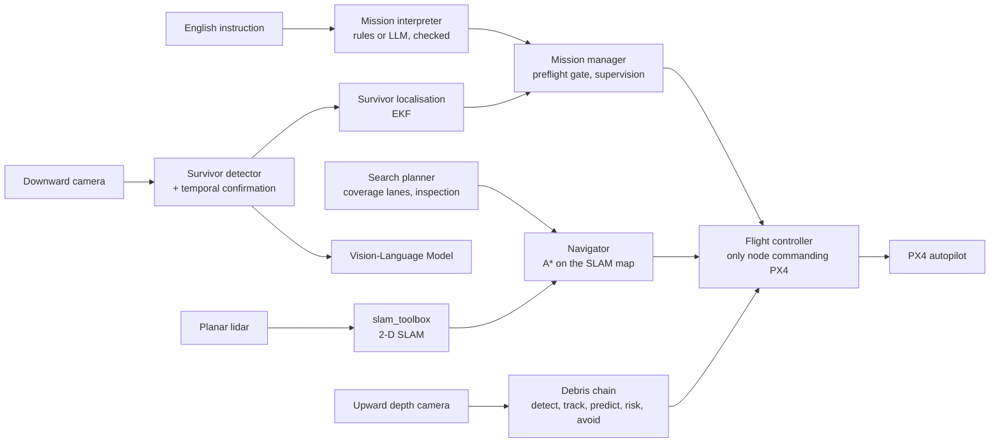

# FRP — Proposed Project Work

## Vision-Language UAV Navigation for GPS-Denied Environments

---

## Contents

1. [Problem Statement](#1-problem-statement)
2. [Objectives](#2-objectives)
3. [Scope](#3-scope)
4. [Proposed Methodology](#4-proposed-methodology)
5. [Tools and Technologies](#5-tools-and-technologies)
6. [Evaluation Plan](#6-evaluation-plan)
7. [Current Status](#7-current-status)
8. [Proposed Work for the Remaining Reviews](#8-proposed-work-for-the-remaining-reviews)
9. [Expected Deliverables](#9-expected-deliverables)
10. [Branch Workflow](#10-branch-workflow)
11. [References](#11-references)

---

## 1. Problem Statement

After an earthquake or a building collapse, rescue teams need to know whether anyone is trapped before they send people into an unstable structure. A small drone can look first, but in such a place it faces three problems at once:

1. **Navigation without reliable GPS.** Satellite signals are weak or blocked close to and inside damaged structures, so the drone must map and route through its surroundings with its own sensors.
2. **Falling debris.** Loose concrete can fall at any moment. A drone that only follows waypoints cannot react in time.
3. **Recognising people.** The drone must decide whether an object it sees is a person, and must never report a survivor it has not verified.

The project builds and evaluates, in simulation, an autonomous UAV that takes a rescue instruction written in one English sentence, searches a disaster area, avoids falling debris, finds survivors, verifies them with a Vision-Language Model (VLM), locates them in 3-D, and returns home to land.

## 2. Objectives

| # | Objective | Measured by |
|---|---|---|
| O1 | Fly a complete autonomous PX4 Offboard mission (arm, take off, search, return, land) from a single supervisory controller | completed and landed flights, PX4 log checks |
| O2 | Detect, track and predict falling debris from an upward depth camera and avoid it | collisions with and without avoidance, warning lead time |
| O3 | Detect survivor candidates from a downward camera and verify them with a VLM, never confirming without one | precision, recall, false confirmations |
| O4 | Estimate each survivor's 3-D position from several views | horizontal localisation error against simulator truth (offline) |
| O5 | Build a map with on-board SLAM and plan collision-free routes through rubble | SLAM error, collisions, routed detours |
| O6 | Turn a natural-language instruction into a bounded, checked mission, refusing unsafe or ambiguous ones | correct interpretations, unsafe acceptances on a held-out set |
| O7 | Show that the autonomy modules do not depend on one simulator | the same modules run in Gazebo + PX4 and in MuJoCo |
| O8 | Move position estimation off GNSS (the GPS-denied goal) | listed as future work in §8 |

## 3. Scope

**In scope**
- Simulation only: PX4 SITL with Gazebo, and a second simulator (MuJoCo).
- Exterior search areas of a procedurally generated urban collapse zone, plus a collapsed-building world used for the debris and survivor studies.
- The x500 quadrotor with a downward camera, an upward depth camera and a planar lidar.

**Out of scope (stated up front)**
- Flight on real hardware.
- Flights inside collapsed interiors: a single 2-D lidar slice cannot see slabs overhead.
- Real victims or real images: survivors are simulated manikins.

**The GPS-denied target.** The project title states the long-term goal. In the current system PX4's estimator (EKF2) still fuses **simulated GNSS** for the drone's own position. SLAM provides the obstacle map used for route planning, but it does not yet provide the pose that stabilises the drone. Replacing GNSS in the estimator is the main proposed future work (§8).

## 4. Proposed Methodology



1. **Layered control.** PX4 runs the fast attitude and position loops. A project-written supervisory controller sends position setpoints at 20 Hz and checks PX4 feedback before every state change. It is the only program allowed to command PX4. Every other module can only *propose* a target, which the controller validates.
2. **Debris avoidance.** The upward depth camera finds objects above the drone. A Kalman filter with gravity as a known input tracks them, a ballistic model predicts their paths, and a closest-approach test labels the risk. A sampling-based planner rolls candidate manoeuvres through a vehicle response model fitted to PX4 flight logs and picks the safest feasible one.
3. **Survivor search.** A coverage planner flies parallel lanes over the area. A colour-and-shape detector finds candidates, which must persist over several frames. The drone then flies to oblique viewpoints so the VLM sees a complete view. The VLM is asked in two steps (neutral description first, then "is this a person?"), and its answer is the only route to a confirmed survivor.
4. **Localisation.** Each survivor is a static 3-D point estimated by an extended Kalman filter from pixel observations taken at different drone positions (triangulation).
5. **Mapping and routing.** A 2-D SLAM map from the planar lidar feeds an A* planner on an inflated occupancy grid. The return home is routed on the map.
6. **Language missions.** The interpreter outputs a fixed set of fields and never coordinates. Places come from a named catalogue, and numbers must appear in the text. Unsafe or out-of-range requests are refused, and the operator confirms a read-back.
7. **Honest evaluation.** Simulator ground truth is logged separately and used only offline for scoring. No running node reads it.

## 5. Tools and Technologies

| Purpose | Tool |
|---|---|
| Robot middleware | ROS 2 Jazzy |
| Autopilot | PX4-Autopilot (SITL), uXRCE-DDS bridge |
| Simulators | Gazebo (Harmonic), MuJoCo 3 |
| Mapping | slam_toolbox |
| Vision-Language Model | Gemma 3 4B served by Ollama |
| Vision and numerics | OpenCV, NumPy, SciPy |
| Testing | pytest, colcon test |
| Version control | Git, GitHub |

## 6. Evaluation Plan

| Area | Metric |
|---|---|
| Flight | mission completion, altitude RMSE, landing offset, failsafes |
| Debris | collisions with and without avoidance, minimum separation, warning lead time |
| Survivors | precision, recall, false confirmations, localisation error |
| Mapping | SLAM pose RMSE against truth |
| Language | correct interpretations and unsafe acceptances on 20 development and 30 held-out instructions |
| Control | controllability rank of the linearised model, closed-loop eigenvalues |

All metrics are computed offline from logs and simulator truth.

## 7. Current Status

| Component | Status |
|---|---|
| Supervisory flight controller, safety monitor, failsafe | Implemented |
| Debris detection, tracking, prediction, risk, avoidance | Implemented and evaluated; fails under hard acceleration and sideways throws |
| Survivor detection, temporal confirmation, VLM verification | Implemented; the VLM runs on the CPU on the development laptop (75–130 s per answer) |
| Survivor 3-D localisation (EKF) | Implemented |
| Coverage search planner with inspection viewpoints | Implemented |
| 2-D SLAM and A* navigation | Implemented; exterior areas only |
| Mission from one sentence, mission manager | Implemented |
| Urban earthquake-collapse world (7 scenarios) | Implemented |
| MuJoCo simulator with its own cascaded controller; PX4 in the loop for hover and waypoints | Implemented |
| Unit tests | 552 passing, 5 skipped; 12 MuJoCo tests passing |
| **Position estimation without GNSS (GPS-denied flight)** | **Not yet implemented** |

## 8. Proposed Work for the Remaining Reviews

1. **GPS-denied estimation.** Feed visual-inertial or lidar-inertial odometry into PX4's EKF2 in place of GNSS, then repeat the urban missions without GNSS and compare against the current results.
2. **3-D mapping.** Replace the single lidar slice with a 3-D representation so that overhead slabs are seen. This is a precondition for any interior search.
3. **GPU VLM.** Run the VLM on the GPU to bring an answer from 75–130 s down to seconds. This would make the debris and VLM demonstrations reliable together.
4. **Human-pose detection.** Replace the colour-and-shape baseline with a learned person or pose detector, keeping the VLM verification step.
5. **Evidence and testing.** Commit the result summaries behind every reported number, and add unit tests for the flight controller's state machine.
6. **Hardware-in-the-loop on a real x500** (stretch goal), building on the existing MAVLink HIL bridge used with MuJoCo.

## 9. Expected Deliverables

- A ROS 2 workspace (`src/uav_autonomy`, `src/uav_interfaces`) that builds and passes its tests.
- Reproducible simulation worlds and run scripts for Gazebo + PX4 and MuJoCo.
- Result summaries and figures for every reported metric.
- A README documenting the method, mathematics, results, limitations and installation.
- A demonstration of a full rescue mission from one English sentence.

## 10. Branch Workflow

Following the faculty's instructions:

- `main` is the evaluation branch and is kept updated throughout the project.
- Team members may work on their own branches, for example:

  ```bash
  git checkout -b <name>-<feature>
  git add <files>
  git commit -m "Describe the change"
  git push origin <name>-<feature>
  ```

- Finished work is merged into `main` through a pull request, so that everything ends up in the single `main` branch for evaluation.
- Before each review, every branch is checked to be merged into `main`.

## 11. References

1. X. Wang, D. Yang, Z. Wang, H. Kwan, J. Chen, W. Wu, H. Li, Y. Liao and S. Liu, "Towards Realistic UAV Vision-Language Navigation: Platform, Benchmark, and Methodology," *International Conference on Learning Representations (ICLR)*, 2025. arXiv:2410.07087. [Paper](https://arxiv.org/abs/2410.07087) · [Code](https://github.com/buaa-colalab/TravelUAV)
2. PX4 Autopilot User Guide, ROS 2 and uXRCE-DDS. <https://docs.px4.io/main/en/ros2/>
3. S. Macenski and I. Jambrecic, "SLAM Toolbox: SLAM for the dynamic world," *Journal of Open Source Software*, 6(61), 2783, 2021. <https://doi.org/10.21105/joss.02783>
4. E. Todorov, T. Erez and Y. Tassa, "MuJoCo: A physics engine for model-based control," IEEE/RSJ IROS, 2012. <https://doi.org/10.1109/IROS.2012.6386109>
5. Gemma Team, "Gemma 3 Technical Report," arXiv:2503.19786, 2025. <https://arxiv.org/abs/2503.19786>
6. ROS 2 Jazzy documentation. <https://docs.ros.org/en/jazzy/>
