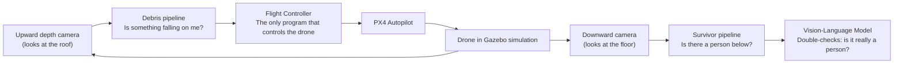
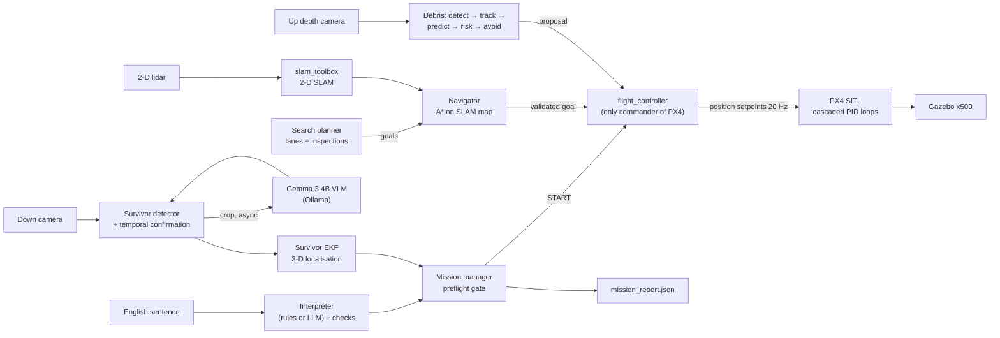
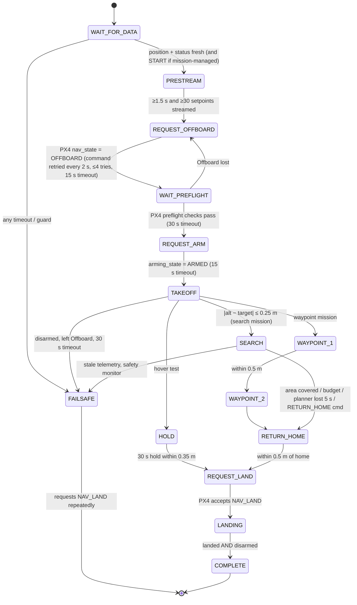

<p align="center">
  
</p>

# Vision-Language UAV Navigation for GPS-Denied Environments

### Vision-Language Navigation | UAV | Computer Vision | GPS-Denied Navigation | ROS 2 | PX4 | Gazebo

---

## Team Members

| S. No. | Name | Roll Number | Email |
|---|---|---|---|
| 1 | JENISHAA BHARATHI M | CB.SC.U4AIE24221 | cb.sc.u4aie24221@cb.students.amrita.edu |
| 2 | NAVEEN K | CB.SC.U4AIE24235 | cb.sc.u4aie24235@cb.students.amrita.edu |
| 3 | POOJA N | CB.SC.U4AIE24242 | cb.sc.u4aie24242@cb.students.amrita.edu |
| 4 | PRANESH M | CB.SC.U4AIE24345 | cb.sc.u4aie24345@cb.students.amrita.edu |
| 5 | SANDHIYA D | CB.SC.U4AIE24353 | cb.sc.u4aie24353@cb.students.amrita.edu |

---

## Table of Contents

1. [The Project in One Minute](#1-the-project-in-one-minute)
2. [Why This Problem Matters](#2-why-this-problem-matters)
3. [Key Terms Used in This README](#3-key-terms-used-in-this-readme)
4. [How the System Works (Big Picture)](#4-how-the-system-works-big-picture)
5. [Part 1 – Flying the Drone](#5-part-1--flying-the-drone)
6. [Part 2 – Avoiding Falling Debris](#6-part-2--avoiding-falling-debris)
7. [Part 3 – Finding Survivors](#7-part-3--finding-survivors)
8. [The Simulated World](#8-the-simulated-world)
9. [What Is Inside This Repository](#9-what-is-inside-this-repository)
10. [Results](#10-results)
11. [Testing](#11-testing)
12. [How to Build and Run](#12-how-to-build-and-run)
13. [Base Paper](#13-base-paper)
14. [License](#14-license)

**Part II — the complete system (current version)**

15. [Control Logic, Dynamics and Controllability (main part)](#15-control-logic-dynamics-and-controllability-main-part)
16. [Mission from One Sentence](#16-mission-from-one-sentence)
17. [The Urban Earthquake-Collapse World](#17-the-urban-earthquake-collapse-world)
18. [Search Planning, SLAM and Path Planning](#18-search-planning-slam-and-path-planning)
19. [Survivor Confirmation with a Real VLM, and 3-D Localisation](#19-survivor-confirmation-with-a-real-vlm-and-3-d-localisation)
20. [Second Simulator: MuJoCo](#20-second-simulator-mujoco)
21. [Results of the Complete System](#21-results-of-the-complete-system)
22. [Demo Commands (tested)](#22-demo-commands-tested)
23. [Tests (current)](#23-tests-current)
24. [Honest Limitations](#24-honest-limitations)
25. [Metric Definitions](#25-metric-definitions)

---

## 1. The Project in One Minute

Imagine a building has collapsed after an earthquake. Rescue teams want to know if anyone is trapped inside, but it is too dangerous to send people in first.

**Our idea:** send a drone in instead.

But a drone inside a collapsed building faces three big problems:

| Problem | Why it is hard | What our system does |
|---|---|---|
| **No GPS** | GPS signals do not reach inside buildings | The drone uses only its own onboard sensors to know where it is |
| **Falling debris** | Pieces of the broken roof can fall at any moment | An upward-facing camera spots falling objects and the drone moves out of the way |
| **Finding people** | The drone must decide whether something it sees is a person | A downward camera finds possible survivors, and an AI model that understands images and language (a **Vision-Language Model**) double-checks them |

Everything runs in a **computer simulation**, so we can test safely without crashing a real drone.

> **Update:** the project now runs a full rescue mission from one English sentence in **two simulators** (Gazebo + PX4 + ROS 2, and MuJoCo), with SLAM, search planning, a real Vision-Language Model and falling-debris avoidance. See **Part II** (§15 onwards). Note that in the final system PX4 still uses simulated GNSS for its own position; see the clarification at the start of Part II.

---

## 2. Why This Problem Matters

Most drones today fly by following GPS points or by being controlled by a pilot. Neither works well in disaster zones:

- GPS does not work indoors or under rubble.
- A pilot outside cannot see what the drone sees quickly enough to dodge something falling.
- Drones that only follow fixed instructions cannot "understand" what they are looking at.

Our project is a step towards drones that can **see, understand and react on their own** in such places.

---

## 3. Key Terms


| Term | Meaning |
|---|---|
| **UAV** | Unmanned Aerial Vehicle, i.e. a drone |
| **GPS-denied** | A place where GPS does not work, like inside a building |
| **PX4** | Free, open-source software that keeps a drone stable in the air. It is the drone's "autopilot" |
| **Offboard mode** | A PX4 mode where an outside program tells the drone where to go |
| **ROS 2** | Robot Operating System. It lets different programs (called **nodes**) send messages to each other |
| **Node** | One small program in ROS 2 that does one job, for example "detect debris" |
| **Topic** | A named channel nodes use to send messages, for example `/camera/image_raw` |
| **Gazebo** | A 3D simulator with realistic physics and cameras |
| **SITL** | Software-In-The-Loop: running the real PX4 autopilot on a computer instead of a real drone |
| **Depth camera** | A camera that measures how far away each point is, not just its colour |
| **VLM** | Vision-Language Model: an AI that can look at an image and answer questions about it in words |
| **Kalman filter** | A maths method that combines noisy measurements over time to get a better estimate of where something is and how fast it moves |
| **Ground truth** | The exact true positions known by the simulator. We use it only to **check** our results, never to help the drone |

---

## 4. How the System Works (Big Picture)

The drone has **two cameras** and runs **three main jobs** at the same time.



Two important rules we followed:

1. **Only one program controls the drone.** The flight controller is the only program allowed to send commands to PX4. Other programs can only *suggest* a move, and the flight controller checks the suggestion is safe before using it.
2. **The drone never cheats.** The drone only uses what its own cameras and sensors can see. The simulator's true positions are saved separately and used only afterwards to grade how well the drone did.

---

## 5. Part 1 – Flying the Drone

**File:** `src/uav_autonomy/uav_autonomy/flight_controller.py`

The flight controller makes the drone fly a full mission by itself. It goes through these steps one after another:

```text
Wait for sensor data
      ↓
Switch PX4 to Offboard mode
      ↓
Arm the motors
      ↓
Take off to 3 metres
      ↓
(Optional) Fly to waypoint 1 → waypoint 2 → back home
      ↓
Hover
      ↓
Land
      ↓
Done
```

If anything goes wrong at any step (for example a timeout), it switches to a **failsafe** state.

> **Update:** in the final missions the drone takes off to 6 m and the `SEARCH` state follows goals from the search planner; the full state machine, guards, setpoint arbitration and the controllability analysis are in **§15**.

Supporting files:

| File | What it does |
|---|---|
| `flight_safety.py` | Watches the drone's position and raises a flag if it goes outside safe limits (for example too high or too low) |
| `avoidance_interface.py` | The safety rules used to accept or reject a dodge suggestion |
| `state_bridge.py` | Converts the drone's position from PX4's coordinate system to the one ROS 2 tools use, so it can be shown in visual tools like RViz |

---

## 6. Part 2 – Avoiding Falling Debris

### Why an upward camera?

At first we only had the normal downward camera. We tested it with 20 falling objects and found it **never saw a single one in time**. So we added an **upward-facing depth camera** that looks at the roof. This gave the drone about **1 second of warning** on average, which is enough to move.

### The five steps

The debris system works like a chain. Each step passes its result to the next.

```text
1. DETECT     →  2. TRACK      →  3. PREDICT     →  4. ASSESS RISK   →  5. DODGE
"I see an        "That's the       "It will land     "It will hit me     "Move 1 m
 object above"    same object       here in 1.2 s"    in 0.8 s!"          to the left"
                  as before"
```

| Step | What happens, in simple words | Files |
|---|---|---|
| **1. Detect** | Looks at the depth image, finds blobs that are closer than the roof, and works out their 3D position | `debris_detection.py`, `debris_depth_detector.py` |
| **2. Track** | Matches each new detection to objects seen earlier, so every falling object gets an ID and a speed (uses a Kalman filter) | `debris_tracking.py`, `debris_tracker.py` |
| **3. Predict** | Guesses where each object will be in the next 2 seconds. We tried three ways: constant speed, estimated acceleration, and **gravity**. Gravity was by far the best | `debris_prediction.py`, `debris_predictor.py` |
| **4. Assess risk** | Checks how close each object will come to the drone and labels it **SAFE**, **WATCH**, **WARNING** or **CRITICAL** | `debris_risk.py`, `debris_risk_node.py` |
| **5. Dodge** | Tries many possible moves (stay, move left, right, forward, down…), simulates how the drone would actually fly each one, throws away any that are unsafe, and picks the best of the rest | `debris_avoidance.py`, `debris_avoidance_node.py` |

The dodge step only **suggests** a move. The flight controller checks it and decides.

**Debris for testing** is dropped in the simulator by `continuous_debris_spawner.py`. It drops real physical boxes that fall under gravity, and uses a fixed random seed so every test can be repeated exactly.

---

## 7. Part 3 – Finding Survivors

In our simulated building there is a **manikin** (a dummy person) wearing orange clothes, with a skin-coloured head and blue legs.

### The three steps

```text
1. FIND CANDIDATES    →    2. CONFIRM OVER TIME    →    3. ASK THE VLM
"There's something         "I've seen it in many         "Is this really
 orange and person-          frames, it's not a            a person?"
 shaped down there"          one-off glitch"
```

| Step | What happens, in simple words | File |
|---|---|---|
| **1. Find candidates** | Looks for orange regions in the image, then checks whether a head, legs and a body-like shape are attached. Gives a score from 0 to 1 | `survivor_detection.py` |
| **2. Confirm over time** | Ignores anything seen in only one frame. A candidate must appear again and again before it is reported | `survivor_confirmation.py` |
| **3. Ask the VLM** | Cuts out a small image of the candidate and sends it to a Vision-Language Model to check if it is a person | `vlm_client.py` |

All three are joined together in `survivor_perception_node.py`.

### How we ask the VLM

We ask in **two separate questions**:

1. *"Describe the main object in this picture."* (We do not mention people, so we don't lead the AI.)
2. *"Does this description sound like a person?"*

We first tried asking directly *"Is this a person?"*, but the small AI models we used either said **yes to everything** or **no to everything**, depending on the wording. Splitting it into two questions fixed this.

### What the drone reports

| Label | Meaning |
|---|---|
| `CANDIDATE` | Looks like a person, waiting for the VLM to answer |
| `SURVIVOR_CONFIRMED` | The VLM agrees it is a person |
| `UNCERTAIN` | Not sure, or the detector and the VLM disagree |
| `REJECTED` | Not a person |

If the VLM is switched off or fails, the drone **never** says "confirmed". It stays at `CANDIDATE` or `UNCERTAIN`.

### Finding the survivor's position in 3D

**Files:** `survivor_localization.py`, `survivor_localization_node.py`

A single camera image only tells you the **direction** of the person, not how far away they are. So the drone combines views from different positions as it flies. Where the lines of sight cross, that is where the person is (this is called **triangulation**). The result is the survivor's position in the drone's own map.

---

## 8. The Simulated World

| File | What it is |
|---|---|
| `worlds/collapsed_building_rescue.sdf` | The main world: a building with broken walls, a hole in the roof, fallen concrete, rubble and the survivor manikin |
| `worlds/depth_validation.sdf` | An empty world used only to test that the depth camera measures distances correctly |
| `worlds/survivor_variants/` | Six versions of the main world for testing the survivor search (see below) |
| `models/x500_rescue/` | Our drone: the PX4 X500 quadcopter with a downward camera and an upward depth camera |
| `models/depth_cam_up/` | The upward depth camera (640×480 pixels, 30 frames per second, sees from 0.2 m to 35 m) |

The six test worlds:

| World | What is different | What it tests |
|---|---|---|
| `occluded` | A panel partly hides the survivor | Can it still find a partly hidden person? |
| `rubble` | Rubble around the survivor | Can it handle a cluttered scene? |
| `outdoor` | Survivor in an open area | Different lighting and background |
| `none` | No survivor at all | Does it wrongly "find" someone who isn't there? |
| `multi` | Several survivors | Can it find more than one? |
| `distractors` | Orange and skin-coloured objects that are not people | Can it avoid being fooled? |

---

## 9. What Is Inside This Repository

```text
├── amrita.png                  University logo
├── LICENSE                     MIT License
├── README.md                   This file
│
├── src/uav_autonomy/           The main ROS 2 package
│   ├── uav_autonomy/           All the Python code (flight, debris, survivors)
│   ├── worlds/                 Simulated environments
│   ├── models/                 The drone and its cameras
│   ├── config/                 Settings for connecting Gazebo cameras to ROS 2
│   ├── launch/                 A launch file to start the perception nodes together
│   └── test/                   Automatic tests
│
├── scripts/                    Tools to run flights and grade results
│   ├── run_flight_trial.sh     Starts the whole simulation and flies one mission
│   ├── demo_live.sh            A visual demo with falling debris
│   ├── sensor_study/           Experiments to decide which camera to use
│   ├── sensor_integration/     Checks that the camera and clocks are correct
│   ├── perception/             Grades debris detection, tracking, prediction and risk
│   ├── avoidance/              Runs and grades debris-dodging flights
│   └── survivor/               Runs and grades survivor-search flights
│
├── simulation/object-track/    Our first prototype (see below)
│
└── results/final/figures/      The 20 result images shown in Section 10
```

### Main programs in the package

| Program | Job |
|---|---|
| `flight_controller` | Flies the mission; the only program that commands the drone |
| `state_bridge` | Shares the drone's position with other ROS 2 tools |
| `debris_depth_detector` | Step 1 of debris: detect |
| `debris_tracker` | Step 2 of debris: track |
| `debris_predictor` | Step 3 of debris: predict |
| `debris_risk` | Step 4 of debris: assess risk |
| `debris_avoidance` | Step 5 of debris: suggest a dodge |
| `debris_perception` | A simpler debris detector that uses the normal camera |
| `survivor_perception` | Finds survivors and asks the VLM |
| `survivor_localization` | Works out where survivors are in 3D |
| `continuous_debris_spawner` | Drops test debris in the simulator |

### Older files kept for reference

`rescue_mission.py` (and its `.backup`), `vlm_detector.py` and `vlm_perception.py` are from our **first attempt**, where everything was in one program and detection used simple colour matching. The files `dynamic_obstacle_simulator.py`, `dynamic_obstacle_tracker.py` and `dynamic_obstacle_vision.py` are empty placeholders from that stage. They are not used by the final system.

### Our first prototype

`simulation/object-track/` is where the project began. Using a lighter simulator called **PyBullet**, a drone follows a moving green ball using only its camera:

- `moving_target.py` moves the ball in a circle, figure-8 or random path.
- `camera_tracker.py` finds the green ball in the image and uses **PID controllers** to turn "the ball is to the left of centre" into "move left".
- `track_demo.py` runs it. You can move the ball yourself with the W/A/S/D/R/F keys.

```bash
cd simulation/object-track
pip install -r requirements.txt
python3 track_demo.py
```

---

## 10. Results

All result images are in `results/final/figures/`.

### Choosing the right camera

| Camera | Average warning before debris reaches the drone |
|---|---|
| Normal downward camera | **0.00 s** (it saw none of the 20 falling objects in time) |
| Upward depth camera | **about 0.98 s** |

This is why we added the upward camera. (See figures `03` and `04`.)

### How well we predict where debris will fall

Error 2 seconds into the future (lower is better):

| Method | Error |
|---|---|
| Assume constant speed | 19.06 m |
| Estimate acceleration | 10.81 m |
| **Use gravity** | **0.41 m** |

(See figure `07`.)

### Dodging falling debris

| Test | What happens | Hits | Closest distance |
|---|---|---|---|
| Direct hits | Boxes dropped straight onto the drone | 0 out of 3 | 1.66 m |
| Multiple objects | Several boxes falling at once | 0 out of 5 | 0.91 m |
| Fast flight | Drone flying at 4.4 m/s | 0 out of 3 | 2.68 m |
| Camera gap | Camera blacks out for 0.5 s | 0 out of 3 | 0.64 m |
| Hard acceleration | Drone already speeding up hard | **1 out of 3** | 0.37 m |
| Sideways throw | Box thrown sideways, not dropped | **1 out of 3** | 0.16 m |

The last two are **failures**, and we have included them on purpose. They show the situations our system cannot yet handle. (See figures `09` to `14`.)

### Finding survivors

| Figure | What it shows |
|---|---|
| `15_survivor_confirmed_by_vlm.jpg` | A survivor found and confirmed by the VLM |
| `16_survivor_distractor_scene.jpg` | Orange objects correctly rejected as "not a person" |
| `17_survivor_outdoor_pass.jpg` | A case where the detector and VLM disagree, so the drone reports "uncertain" |
| `18_vlm_dataset_samples.jpg` | Example image crops used to test the VLM |

### Final demo check (06-10-2026)

| Figure | What it shows |
|---|---|
| `19_demo_check_2026-10-06_avoidance.png` | Direct-hit test repeated: 0 hits out of 3, closest distance 1.83 m |
| `20_demo_check_2026-10-06_survivor_candidate.jpg` | With the VLM turned off, the drone correctly stops at "candidate" and does not claim a confirmed survivor |

### Demo video


https://github.com/user-attachments/assets/2fb6d563-4f80-4912-8aa7-344652a465b7


---

## 11. Testing

> **Update:** this was the first version. The current count is **557 tests (552 pass, 5 skipped)**, see §23.

The folder `src/uav_autonomy/test/` contained **318 automatic tests** that check each part of the code works as expected, plus code-style checks.

| What is tested | Number of tests |
|---|---|
| Survivor perception | 79 |
| Debris avoidance | 68 |
| Debris tracking | 36 |
| Debris risk | 35 |
| Survivor localisation | 35 |
| Debris prediction | 22 |
| Debris detection | 21 |
| Flight safety | 21 |

To run them:

```bash
colcon test --packages-select uav_autonomy
colcon test-result --verbose
```

---

## 12. How to Build and Run

### What you need

- Ubuntu with **ROS 2 Jazzy**
- **PX4-Autopilot** with Gazebo (the scripts look for it in a folder next to this project called `PX4-Autopilot`)
- The `px4_msgs` and `uav_interfaces` message packages in the same ROS 2 workspace
- `ros_gz_bridge` and the Micro XRCE-DDS Agent
- Python libraries: `numpy`, `scipy`, `opencv`
- *(Optional)* A Vision-Language Model server, for example Ollama, for survivor checking

### Build

```bash
source /opt/ros/jazzy/setup.bash
cd <your_workspace>
colcon build --packages-select uav_autonomy
source install/setup.bash
```

### Run

```bash
# Fly one simple mission (take off, hover, land)
scripts/run_flight_trial.sh results/trial_01 hover

# Watch a live demo with falling debris
scripts/demo_live.sh

# Debris test: first without dodging, then with dodging
scripts/avoidance/run_scenario.sh C_direct baseline
scripts/avoidance/run_scenario.sh C_direct avoid

# Survivor search using a VLM
export VLM_ENDPOINT=http://localhost:11434/v1
export VLM_MODEL=<model-name>
scripts/survivor/run_scenario.sh A_clear
```


---

## 13. Base Paper

This project is inspired by the UAV Vision-Language Navigation problem studied in:

> **Towards Realistic UAV Vision-Language Navigation: Platform, Benchmark, and Methodology**

**Paper:**  
https://arxiv.org/pdf/2410.07087

**TravelUAV Repository:**  
https://github.com/buaa-colalab/TravelUAV

The paper provides the research foundation for the Vision-Language Navigation aspect of this project, while this repository develops an independent simulation and ROS 2–PX4 based implementation.

---

## 14. License

This project is released under the MIT License. See [`LICENSE`](LICENSE).

---

<div align="center">

### Amrita Vishwa Vidyapeetham

**Vision-Language UAV Navigation for GPS-Denied Environments**

</div>

---

# Part II — The Complete System (current version)

Sections 1–14 above describe how the project started: one collapsed building, the debris
chain and the survivor pipeline. Since then the project has grown into a complete rescue
mission that runs in **two separate simulators**. The sections below cover everything that
was missing above. **Section 15 (control logic and controllability) is the core of the
project.**

| Area | Where it is described |
|---|---|
| **Control logic, dynamics and controllability (main part)** | §15 |
| Mission from one English sentence, mission manager, preflight gate | §16 |
| The urban earthquake-collapse world | §17 |
| Search planning, SLAM, path planning | §18 |
| Survivor confirmation with a real VLM, 3D localisation | §19 |
| The second simulator (MuJoCo) | §20 |
| Results of the complete system | §21 |
| Exact demo commands | §22 |
| Tests | §23 |
| Honest limitations | §24 |
| Metric definitions | §25 |

> **Clarification of the claims in §1–§2.** In the final system PX4 estimates the drone's
> own position with its EKF2 using simulated IMU, barometer, magnetometer **and GNSS**.
> **SLAM** (§18) builds the obstacle map, and the route planner uses it to fly around rubble
> and walls. So the system *navigates* by a map it builds itself, but it is **not**
> GPS-denied *flight*. Section 24 lists this as a limitation, and replacing GNSS in the
> estimator is the main future step. Simulator ground truth is never used by any running
> node. It is used only afterwards, to score the results.

The full mission, as it runs in Gazebo:



---

## 15. Control Logic, Dynamics and Controllability (main part)

The drone is controlled by **four nested layers**. Each layer only gives targets to the
layer below it, and each layer checks the feedback from the layer below before it goes on.

| Layer | Runs in | Rate | Input → output | Feedback it uses |
|---|---|---|---|---|
| 4. Mission supervision | `mission_manager_node.py` + `mission_logic.py` | 2 Hz | mission file → START / RETURN_HOME / LAND_NOW | flight status, perception health, battery, VLM availability |
| 3. Supervisory flight controller | `flight_controller.py` (state machine) | 20 Hz tick, 20 Hz setpoints | goals and avoidance proposals → **one position setpoint** | PX4 position, arming, nav state, landed flag, telemetry age |
| 2. Position / velocity loops | PX4 `mc_pos_control` | PX4 internal (estimator rate) | position setpoint → thrust vector + attitude setpoint | EKF2 position and velocity |
| 1. Attitude / rate loops, mixer | PX4 `mc_att_control`, `mc_rate_control`, control allocator | PX4 internal (gyro rate) | attitude setpoint → 4 motor commands | gyro, attitude estimate |

In the **MuJoCo** simulator, layers 1 and 2 are the project's own cascaded controller
(`simulation/mujoco/controllers/quadrotor.py`), and layers 3–4 are a Python mission loop
(`simulation/mujoco/scripts/run_mission.py`). The model and gains of both are given below.

### 15.1 The vehicle (x500) and its equations of motion

Parameters, taken from the PX4 `x500` model and used identically in MuJoCo:

| Quantity | Value |
|---|---|
| Mass m | 2.064 kg |
| Inertia (Ixx, Iyy, Izz) | 0.02167, 0.02167, 0.040 kg·m² |
| Rotor thrust constant k_f | 8.54858 × 10⁻⁶ N/(rad/s)², ω_max = 1000 rad/s |
| Max thrust per rotor | 8.55 N (4 rotors: 34.2 N) |
| Weight | 20.25 N → hover thrust 5.06 N per rotor (59 % of max) |
| Thrust-to-weight ratio | **1.69** |
| Motor time constant | 0.0125 s spin-up, 0.025 s spin-down |
| Reaction-torque coefficient k_m | 0.016 m |
| Rotor positions (x, y) | (±0.13, ±0.22 / ±0.20) m |

Rigid-body dynamics (world frame z-up; R is the body-to-world rotation, T is the total thrust
along body z, and **τ** is the body torque):

$$
m\,\ddot{\mathbf p} = -m g\,\mathbf e_z + T\,\mathbf R\,\mathbf e_z, \qquad
\mathbf J\,\dot{\boldsymbol\omega} = \boldsymbol\tau - \boldsymbol\omega \times \mathbf J\boldsymbol\omega, \qquad
\dot{\mathbf R} = \mathbf R\,[\boldsymbol\omega]_\times
$$

**Control allocation.** The four motor thrusts f₁…f₄ map to the collective thrust and the
three torques through a 4 × 4 matrix (from the rotor geometry above):

$$
\begin{bmatrix}T\\ \tau_x\\ \tau_y\\ \tau_z\end{bmatrix}
=\underbrace{\begin{bmatrix}1&1&1&1\\ 0.22&-0.22&0.20&-0.20\\ -0.13&-0.13&0.13&0.13\\ -k_m&k_m&k_m&-k_m\end{bmatrix}}_{\mathbf A_{alloc}}
\begin{bmatrix}f_1\\ f_2\\ f_3\\ f_4\end{bmatrix}
$$

rank(A_alloc) = 4 and its condition number is 62.6. The matrix is invertible, so **any
demanded (T, τ) within the motor limits maps to exactly one set of motor thrusts**. The
large condition number comes from the small yaw arm (k_m = 0.016 m). It means that yaw is
the weakest axis, which is why the controllers limit the yaw rate (1 rad/s in MuJoCo).

### 15.2 Linearisation about hover

State **x** = [x, y, z, vx, vy, vz, φ, θ, ψ, p, q, r]ᵀ (12 states), input
**u** = [ΔT, τx, τy, τz]ᵀ. For small angles around hover (T = mg):

$$
\dot x = v_x,\ \dot y = v_y,\ \dot z = v_z,\quad
\dot v_x = g\,\theta,\ \dot v_y = -g\,\phi,\ \dot v_z = \Delta T/m,\quad
\dot\phi = p,\ \dot\theta = q,\ \dot\psi = r,\quad
\dot p = \tau_x/J_{xx},\ \dot q = \tau_y/J_{yy},\ \dot r = \tau_z/J_{zz}
$$

i.e. $\dot{\mathbf x} = \mathbf A\mathbf x + \mathbf B\mathbf u$. The horizontal axes form a
**4th-order chain**: torque → angular rate → angle → acceleration (g·θ) → velocity →
position. The vertical axis and yaw are each 2nd-order chains.

### 15.3 Controllability: result

A linear system is controllable when every state can be driven to any value in finite
time. **Kalman test:** rank 𝒞 = n with 𝒞 = [B AB A²B … Aⁿ⁻¹B]. **PBH test**
(Popov–Belevitch–Hautus): rank [λI − A, B] = n for every eigenvalue λ of A. The PBH test
is used as the decisive test because it stays numerically exact when 𝒞 is badly scaled.

Computed by `scripts/analysis/controllability.py` (output in `results/analysis/controllability.json`):

| Model | States | Inputs | Kalman rank (numeric) | PBH rank | Result |
|---|---|---|---|---|---|
| Rigid body, u = [ΔT, τx, τy, τz] | 12 | 4 | 12 | 12 | **controllable** |
| Rigid body, u = 4 motor thrusts (through A_alloc) | 12 | 4 | 12 | 12 | **controllable** |
| Rigid body + first-order motor lag, u = 4 motor commands | 16 | 4 | 4 * | 16 | **controllable** |
| Horizontal chain [x, vx, θ, q], u = τy | 4 | 1 | 4 | 4 | **controllable** |
| Counter-example: thrust only (no torques) | 12 | 1 | 2 | 9 | **not controllable** |

\* The 16-state Kalman matrix contains powers of the motor pole (80 s⁻¹)¹⁵ ≈ 3.5 × 10²⁸.
These swamp the other columns, so the numerical rank is understated. The PBH test shows full
rank, which is expected: an invertible first-order lag in front of a controllable system
stays controllable.

**What this means.**
- With four independent motors (A_alloc invertible), the linearised x500 can reach any
  position, velocity, attitude and rate. This is why the flight software can treat
  horizontal position as a commandable quantity even though the drone has **no direct
  horizontal actuator**. Horizontal motion is reached **through attitude**, which is why it
  is slower (§15.5).
- The counter-example shows why the torques are essential. Thrust alone only moves z and vz
  (Kalman rank 2): a quadrotor that could only throttle up and down could never move sideways.
- Controllability is a property of the **linear model at hover**. It does **not** prove
  stability (§15.5 does that for the closed loop). It also does not account for limits:
  the 1.69 thrust-to-weight ratio, the tilt limit (45° in PX4, 32° in MuJoCo) and motor
  saturation bound how *fast* states can be reached.

### 15.4 Inner loops actually used

**PX4 (Gazebo runs; default gains, unchanged):**

| Loop | Law | Gains (PX4 parameter = value) |
|---|---|---|
| Position | $\mathbf v_{sp} = K_p(\mathbf p_{sp} - \mathbf p)$ | MPC_XY_P = 0.95, MPC_Z_P = 1.0 |
| Velocity | PID → acceleration / thrust vector | MPC_XY_VEL_P/I/D_ACC = 1.8 / 0.4 / 0.2; MPC_Z_VEL_P/I_ACC = 4.0 / 2.0 |
| Attitude | P on attitude error (quaternion) | MC_ROLL_P = MC_PITCH_P = 4.0, MC_YAW_P = 2.8 |
| Body rate | PID | MC_ROLLRATE_P/I/D = 0.15 / 0.2 / 0.003, MC_YAWRATE_P = 0.2 |
| Limits | | MPC_XY_VEL_MAX 12 m/s, up 3 m/s, down 1.5 m/s, MPC_TILTMAX_AIR 45°, hover throttle 0.6 (x500) |


### 15.5 Closed-loop stability (linearised)

Closing the loop around the hover model with the MuJoCo gains, and using the response model
that the project fitted to real PX4 flight logs (`debris_avoidance.AvoidanceParams`:
τ = 0.493 s, kp = 0.827, kv = 3.203), gives these eigenvalues. All of them have negative
real parts, so the loops are **asymptotically stable**:

| Loop | Eigenvalues (s⁻¹) | Slowest / least damped mode | 1 m step: rise 10–90 % | Overshoot | 2 % settling |
|---|---|---|---|---|---|
| MuJoCo, horizontal (5 states incl. integrator) | −11.50; −2.97 ± 2.81j; −2.40; −0.155 | ζ = 0.73 (ωn 4.1 rad/s) | 1.04 s | 0 % | 2.06 s |
| MuJoCo, vertical (with motor lag) | −76.7; −1.56 ± 1.12j; −0.155 | ζ = 0.81 (ωn 1.9 rad/s) | 1.33 s | 0.8 % | 2.07 s |
| PX4, horizontal (fitted from logs) | −0.98; −0.52 ± 2.28j | ζ = 0.22 (ωn 2.3 rad/s) | 1.10 s | 2.7 % | 5.07 s |


The pole at −0.155 is the slow velocity integrator. It removes steady offsets, such as rotor
drag in steady flight, without affecting the fast response. The PX4 fit has a lightly damped
mode. That model was fitted for **1 s-ahead prediction** in the avoidance planner (largest
error 0.25 m over 133 start states), not as a gain design.

### 15.6 Layer 3: the supervisory flight controller (`flight_controller.py`)

The project's flight controller is a **supervisory, setpoint-based controller**. It does not
implement PID itself. It closes the loop *logically*: every state transition tests PX4
feedback. It is the **only** node that publishes to PX4 (`/fmu/in/trajectory_setpoint`,
`/fmu/in/offboard_control_mode` with position = true, `/fmu/in/vehicle_command`).



**Guards and timeouts (exact values in the code):**

| Item | Value |
|---|---|
| Control tick / setpoint rate | 0.05 s / 20 Hz |
| Pre-stream before Offboard | 1.5 s |
| Command retry / attempts | 2.0 s / 4 |
| Telemetry freshness (position, status) | 1.0 s (urban runs: status 3.0 s; CPU-VLM demo: status 8.0 s, position 3.0 s — parameters `status_timeout_s`, `position_timeout_s`) |
| Mode / preflight / arm timeouts | 15 / 30 / 15 s |
| Takeoff | target 3 m (6 m in the urban missions), tolerance 0.25 m, timeout 30 s |
| Waypoint arrival | 0.5 m radius, optional arrival speed limit, timeout 45 s |
| Landing | NAV_LAND accepted → wait for landed + disarmed, timeout 45 s |
| In every airborne state | if PX4 reports disarmed or leaves Offboard → FAILSAFE |

**Setpoint arbitration.** Each tick the controller selects exactly one target:

$$
\mathbf p_{cmd} =
\begin{cases}
\mathbf p_{avoid}, & \text{avoidance proposal active and accepted by } \texttt{validate\_command}\\
\mathrm{limit}(\mathbf p, \mathbf p_{mission}, v_{lim}), & \text{otherwise}
\end{cases}
$$

An avoidance proposal is **accepted only if** it is younger than 0.5 s, finite, at most
6 m from the vehicle, between 1.5 m and 15 m altitude, and the flight state allows
avoidance. Otherwise it is refused and counted. When it ends, the mission step stays
*paused* (its timers frozen) until the vehicle is back within 0.5 m horizontally and 0.35 m
vertically of the mission setpoint.

**Speed cap through the setpoint (`limit_setpoint`).** PX4's position loop commands
v = K_p·e with K_p = MPC_XY_P = 0.95. So a speed limit is enforced *without touching PX4* by
never placing the setpoint further than v_lim / K_p ahead of the vehicle:

$$
\mathbf p_{cmd,xy} =
\begin{cases}
\mathbf p_{mission,xy}, & \lVert\mathbf e_{xy}\rVert \le v_{lim}/K_p\\[3pt]
\mathbf p_{xy} + \dfrac{v_{lim}/K_p}{\lVert\mathbf e_{xy}\rVert}\,\mathbf e_{xy}, & \text{otherwise}
\end{cases}
\qquad \mathbf e_{xy} = \mathbf p_{mission,xy} - \mathbf p_{xy}
$$

The cap is the minimum of the transit limit, the search speed (2.0 m/s, inspection
1.5 m/s, never above 3.0 m/s) and any lower cap that the avoidance planner requests when
perception degrades (never below 0.5 m/s).

**Search goals** from the planner are accepted only if they are younger than 1.0 s and at
most 25 m from home. If there is no valid goal for 5 s, or the 300 s search budget is used
up, the controller begins the return.

### 15.7 Debris avoidance as a control problem

The avoidance planner (`debris_avoidance.py`) is a **sampling-based model-predictive
controller**:
1. Generate candidates: hold, 8 horizontal directions × {2.5 m, 4.0 m}, climb 2 m, descend 1 m.
2. **Roll out** each candidate through the PX4 response model fitted from flight logs
   (per axis: $\dot a = (\mathrm{clip}(k_v(\mathrm{clip}(k_p e, v_{max}) - v), a_{max}) - a)/\tau$,
   with τ = 0.493 s, kp = 0.827, kv = 3.203, a_max = 11.08 m/s²).
3. Reject the candidate if, at any sampled time, the separation from any predicted debris
   path is less than safety radius + uncertainty margin + 0.25 m model error. Also reject it
   if it leaves the altitude or speed limits or enters a structure.
4. Choose the lowest cost among the feasible candidates:
   $J = w_{risk}\,\text{risk} + w_{dist}\,\text{deviation} + w_{energy}\,\text{effort} + w_{smooth}\,\text{change} + w_{alt}\,\Delta h$.

Its state machine is NORMAL_FLIGHT → PREPARE_AVOIDANCE → AVOIDING → CLEARING →
RESUME_MISSION (plus DEFENSIVE and AVOIDANCE_FAILSAFE). If perception gets old, it caps the
speed (DEGRADED or STALE). The result is only a **proposal**, which the flight controller
validates (§15.6).

### 15.8 Safety monitor and failsafe (`flight_safety.py`)

This runs on every PX4 position sample above 0.5 m altitude:

| Check | Trips when |
|---|---|
| Impact | ‖a‖ > 30 m/s² |
| Position jump | ‖Δp − v̄Δt‖ > 0.5 + ½·30·Δt² m |
| Velocity jump | ‖Δv‖ > 3.0 + 30·Δt m/s |
| Speed envelope | v_xy > 6.5 m/s or \|v_z\| > 3.0 m/s |
| Estimator | reset counter changes, or any non-finite value |
| Altitude | excursion > 1.0 m in cruise states |

Any violation latches **FAILSAFE**, which requests PX4 `NAV_LAND`. PX4's own failsafes stay
active underneath. **Fault injection:** killing SLAM or the navigator 60 s into a mission led
to a routed return and a landing. A stock waypoint route that hit a roof was caught by the
monitor at 8.6 s, and the drone landed at 8.7 s.

### 15.9 Measured control performance

| Test | Result |
|---|---|
| Gazebo + PX4, 5 hover flights | altitude RMSE 0.070–0.096 m, drift 0.042–0.059 m, landing offset 0.015–0.059 m |
| PX4 response-model fit (avoidance planner) | largest 1 s-ahead error 0.25 m over 133 start states |
| MuJoCo, own cascade, hover | position RMSE **9.4 mm** |
| MuJoCo, square at 3 m/s | cross-track RMSE 0.53 m, max 1.37 m |
| MuJoCo, routed flight around blocked street | 111 m detour, 0 collisions, closest lidar range 1.69 m |
| **PX4 in the MuJoCo loop** (unchanged PX4 + unchanged `flight_controller.py`, MAVLink HIL) | hover hold RMSE **4.4 cm**; 3 waypoints reached to 0.4 / 17.6 / 0.4 cm; landing offset 0.35 m; 18 of 19 trials complete (1 lockstep hang) |

---

## 16. Mission from One Sentence

**Files:** `mission_language.py`, `scripts/mission/interpret_mission.py`,
`mission_logic.py`, `mission_manager_node.py`, `missions/places_disaster.json`

```
"Search the collapsed apartment block for survivors, only report confirmed ones, and return to base."
   ▼ text screen       refuses: empty, "ignore/disable safety…", feet/miles/hours
   ▼ interpreter       keyword rules (default) or a language model → 9 fixed fields, NO coordinates
   ▼ cross-checks      numbers must appear in the text; place must be named; safety flags OR'ed
   ▼ limits            altitude, time, area; out of range → refuse (nothing is clamped)
   ▼ read-back         operator confirms
   ▼ mission manager   preflight gate → START → search → return → land → report
```

- The interpreter **cannot output coordinates**. A place is always one of the named areas
  in the catalogue (for example `collapsed_block` = north 44–72 m, east 14–27 m, at 6 m
  altitude).
- "Only report confirmed ones" sets `require_vlm`, so the mission **will not take off**
  without a working VLM.
- **Score** on a fixed instruction set (20 development + 30 held-out): rules 24/30 and
  language model 23/30 correct on held-out, with **0 unsafe acceptances**.
- **Preflight gate** (all checks must hold for 2 s): flight controller waiting, perception
  streams younger than 2 s, planner alive, VLM available (if required), debris avoidance
  alive (if required), battery ≥ return level + 10 %.
- **During flight** the manager ends the search on: area covered, time budget, battery,
  perception lost, debris protection lost, or a confirmed survivor (if the policy says so).
  Then it writes `mission_report.json`.

---

## 17. The Urban Earthquake-Collapse World

**Files:** `scripts/disaster/make_disaster_zone.py` (procedural generator),
`scripts/disaster/validate_disaster.py`, `src/uav_autonomy/worlds/disaster/`

- A dark urban disaster zone: damaged multi-storey concrete blocks with exposed floors, a
  collapsed block with a rubble field, a U-shaped courtyard, and a street blocked by rubble
  that forces a detour. It has about 39 000 triangles and procedural concrete, rubble and
  asphalt textures.
- 7 scenarios, all from one generator:

| Scenario | Content |
|---|---|
| `urban_A` | no survivors (reconnaissance) |
| `urban_B` | one survivor on the collapse rubble (**main demo**) |
| `urban_B2` | one survivor in the courtyard |
| `urban_C` | three survivors and five look-alikes |
| `urban_D` | two survivors partly under leaning slabs, one look-alike |
| `urban_E` | one survivor inside the collapsed block, under a leaning slab |
| `urban_F` | no survivors, five look-alikes (false-positive control) |

- Look-alikes are an orange barrel, a cone, a tarp, and a crate with a ball. They are made
  to fool a colour detector, so they test the VLM.
- The validator checks heights (≤ 15 m), rubble (≤ 4.5 m), that the 6 m lidar slice hits
  363 structures, that every route the mission needs exists, and that the blocked street
  really forces a detour.
- **Search areas are exterior only.** A 2-D lidar slice cannot see slabs overhead. Two
  early flights into a collapsed interior ended in impacts, so interiors are out of scope.

---

## 18. Search Planning, SLAM and Path Planning

**Files:** `search_planning.py`, `search_planner_node.py`, `slam_bridge_node.py`,
`navigation.py`, `navigator_node.py`, `config/slam_toolbox_urban.yaml`

**Coverage search.** The camera footprint at height h has half-extents
(ℓ_f, ℓ_r) = m·h·(H/2f_y, W/2f_x), with usable margin m = 0.8. Lanes run along the long
side, with spacing 2ℓ⊥(1 − ω) at 50 % overlap, so every ground point is seen twice, once
from above and once obliquely. A 0.5 m grid records which cells the real footprint (from
the real pose) has covered.

**Inspection (approach the survivor).** When a candidate has been seen at least 15 times,
the planner leaves the lanes and flies **2 viewpoints, 90° apart, 2–4 m from the
candidate, about 35° off nadir**, at 1.5 m/s. These oblique, close views:
- give the VLM a clear, complete side view (it rejects straight-down crops), and
- give the localiser a triangulation baseline.

While a VLM answer is pending, the planner **holds the drone at the viewpoint**
(`inspect_timeout_s`). Then it continues the lanes.

**SLAM.** `slam_toolbox` builds a 2-D pose-graph map with scan matching and loop closure,
from a 720-ray planar lidar at 10 Hz. `slam_bridge` levels each scan by the attitude and
keeps only returns within the 6 m flight plane.

**Path planning.** A* runs on a 0.5 m grid built from the SLAM map. Obstacles are inflated
by 1.75 m, there is an extra cost within 4 m of an obstacle, and unknown cells are passable
at an extra cost of 0.6. A 3.5 m look-ahead point is sent as the goal, the route is
replanned every 1 s, and the speed drops to 1.2 m/s within 3 m of obstacles. The **return
home is routed on the SLAM map at search altitude**, and the climb happens only near home.
This is because a straight climb-and-fly-back under slabs caused an impact during
development.

**SLAM accuracy (against ground truth, offline):** 0.08–0.57 m RMSE in the village world
(17 flights) and 0.5–2.8 m in the urban world, where repetitive facades confuse scan
matching. Stricter settings reduced one 12.5 m drift to about 1.1 m.

---

## 19. Survivor Confirmation with a Real VLM, and 3-D Localisation

**Files:** `survivor_detection.py`, `survivor_confirmation.py`, `vlm_client.py`,
`survivor_perception_node.py`, `survivor_localization.py`

1. **Detect.** An HSV and shape detector finds candidates on the downward camera image
   (score 0–1).
2. **Confirm over time.** A candidate must appear in 5 of 8 frames.
3. **VLM (Gemma 3 4B via Ollama).** A padded crop is sent **asynchronously** in a worker
   thread, so flight control never waits for it. The question is asked in two steps:
   neutral description first, then "is this a person?". Requests are made only **while
   inspecting** (oblique, complete crops), and at most 3 answers are taken per track.
4. **Decision.**

| Situation | Reported as |
|---|---|
| VLM answers *confirm* with confidence ≥ 0.6 | `SURVIVOR_CONFIRMED` |
| VLM rejects, weak detector cues | `REJECTED_BY_VLM` |
| VLM rejects, strong detector cues (≥ 0.55) | `UNCERTAIN` |
| VLM unavailable, timed out or not asked | `UNVERIFIED_CANDIDATE`, **never confirmed** |

5. **Localise.** An extended Kalman filter estimates each survivor as a static 3-D point.
   The measurement is the pixel position (u, v) = project(p), with a 2 × 3 Jacobian and an
   innovation gate. The first ray is intersected with a plane at an assumed height. Once the
   drone moves, the rays from different viewpoints triangulate the point and the assumption
   stops mattering. The pose comes from PX4's estimator; ground truth is never used.

**On this laptop the VLM runs on the CPU** (the NVIDIA driver is not loaded on the current
kernel). One answer takes **75–130 s**, which is why the planner holds at the viewpoint.
The 4B model is noisy: in one run it called the survivor a "toy dart" and a "Lego brick"
before confirming, and in another it never confirmed (the survivor was then reported
`UNVERIFIED`, located 0.1 m off). It correctly rejected the orange tarp look-alike three
times ("orange block", "orange sign", "orange prism"). The system reports exactly what the
VLM answered and never fakes a confirmation.

---

## 20. Second Simulator: MuJoCo

**Folder:** `simulation/mujoco/` (isolated Python venv: only `mujoco` is installed; no
ROS, Gazebo or PX4 needed)

| | Gazebo + PX4 + ROS 2 | MuJoCo |
|---|---|---|
| World | 7 urban scenarios (meshes, shadows) | same layout as boxes and cylinders, same textures (`make_mujoco_scene.py`) |
| Vehicle | x500 in Gazebo | same x500 mass, inertia, rotor geometry, thrust and motor lag |
| Autopilot | **PX4 SITL** (unchanged) | **project's cascaded controller** (§15.4); optional PX4-in-the-loop via MAVLink HIL for hover and waypoints |
| State used by the controller | PX4 EKF2 | simulator state (labelled; no noise) |
| Mapping | slam_toolbox **SLAM** | lidar occupancy grid with **known pose** (not SLAM) |
| Survivor perception | same detector, EKF and **VLM** | same detector, EKF and **VLM**, on rendered frames |
| Planning | same `search_planning.py`, A* `navigation.py` | same modules, called directly |
| Falling debris | 6 boxes; depth → track → predict → risk → avoid | 3 boxes; **the same detector, tracker, risk and planner modules** fed by a rendered upward depth camera (`controllers/debris.py`) |

The second simulator shows that the autonomy modules do not depend on Gazebo or ROS. Its
results are reported separately and are never mixed with the Gazebo results.

---

## 21. Results of the Complete System

**Gazebo + PX4 (urban world, Intel graphics, real-time factor about 0.5)**

| Test | Result |
|---|---|
| Evaluation batch (exterior areas) | **10 / 10** flights complete, landed, all PX4-log checks passed, 0 failsafes |
| Survivors in searched areas | **8 / 9** found, localisation error median **0.21 m**, max 1.07 m |
| Falling debris (6 boxes) | 5 avoidance manoeuvres, **0 collisions**, closest box 1.34 m |
| **VLM mission, final check** (`urban_B`, CPU VLM) | took off, searched, approached, VLM confirmed (after 3 rejects), survivor at 55.0 / 16.87 vs truth 55 / 17 (**0.13 m**), returned, landed |
| VLM mission, earlier run | `SURVIVOR_CONFIRMED`, error 0.09 m |
| Look-alike control (`urban_F`) | tarp **rejected by the VLM** 3 times; nothing confirmed |
| Fault injection | SLAM killed at 60 s → return and land; navigator killed at 60 s → return and land |
| SLAM error | 0.5–2.8 m RMSE (urban), 0.08–0.57 m (village) |

**MuJoCo (standalone controller)**

| Test | Result |
|---|---|
| Missions | 6 / 6 complete and landed, 0 collisions; survivors 6 / 6 (0.21–0.46 m) |
| **VLM mission** (`urban_B`) | VLM confirmed ("blocky human figure", 0.95), survivor 0.21 m off, landed, 0 collisions |
| VLM look-alike control (`urban_F`) | tarp rejected by the VLM |
| **Falling debris** (3 boxes aimed at the drone) | 3 avoidance manoeuvres from the upward depth camera only, closest box 1.88 m, **0 collisions**, survivor found, landed |
| Control | hover RMSE 9.4 mm; PX4-in-the-loop hover 4.4 cm |

Evidence: every run writes `mission_report.json`, flight logs, ULog checks (Gazebo), VLM
crops and decisions.

---

## 22. Demo Commands (tested)

Run one simulator at a time.

**Gazebo + PX4 + ROS 2 with the VLM** (about 12 minutes; the window follows the drone
automatically):

```bash
cd ~/Desktop/drones/ros2_ws && source /opt/ros/jazzy/setup.bash && source install/setup.bash
CONFIRM=yes VIZ=0 scripts/disaster/run_demo.sh "Search the collapsed apartment block for survivors, only report confirmed ones, and return to base." urban_B demo1
```

**MuJoCo with the VLM** (about 4 minutes; start the VLM server first if it is not running:
`cd ~/ollama && OLLAMA_HOST=127.0.0.1:11434 ./bin/ollama serve`):

```bash
cd ~/Desktop/drones/ros2_ws/simulation/mujoco && source .venv/bin/activate
PYGLFW_LIBRARY_VARIANT=x11 MUJOCO_GL=glfw python3 scripts/run_mission.py "Search the collapsed apartment block for survivors, report survivor locations, and return to base." --scene urban_B --vlm gemma3-4b-cpu --gui --out ../../results/demo_mujoco_vlm
```

**MuJoCo with falling debris:**

```bash
PYGLFW_LIBRARY_VARIANT=x11 MUJOCO_GL=glfw python3 scripts/run_mission.py --scene urban_B --debris 3 --gui --out ../../results/demo_mujoco_debris
```

**Controllability analysis:**

```bash
python3 scripts/analysis/controllability.py
```

---

## 23. Tests (current)

**557 automatic tests** in `src/uav_autonomy/test/`: **552 pass, 5 skipped**. The style
checks (flake8/pep257) are reported separately. MuJoCo has 12 more headless tests
(`simulation/mujoco/tests`, all pass).

| Area | Tests |
|---|---|
| Survivor perception (detector, confirmation, VLM handling) | 92 |
| Debris avoidance | 75 |
| Mission language | 61 |
| Mission logic | 57 |
| Search planning | 43 |
| Navigation (A*) | 43 |
| Debris tracking | 42 |
| Survivor localisation | 38 |
| Debris risk | 35 |
| Flight safety | 26 |
| Debris prediction | 24 |
| Debris detection | 21 |

---

## 24. Honest Limitations

- **Not GPS-denied flight.** PX4's EKF2 uses simulated GNSS. SLAM supplies the map, not the
  pose that flies the drone, and in the urban world it is less accurate than PX4's odometry.
- **2-D SLAM.** It is a single 6 m lidar slice. It cannot see slabs overhead, so interiors
  are out of scope.
- **CPU VLM.** Each answer takes 75–130 s and the 4B model is noisy (false rejects and odd
  labels). A GPU driver (kernel 7.0.0-30) would make it about 10× faster.
- **Real-time factor about 0.5** on Intel graphics. Under heavy load, telemetry gaps can
  trip the watchdog; the demo raises `status_timeout_s` / `position_timeout_s` for this,
  and documents it.
- **Debris:** about 1 s of warning; failures with hard acceleration and sideways throws
  (§10). Debris together with the CPU VLM in Gazebo was not reliable (failsafes from load),
  so the debris demo is shown separately.
- **MuJoCo:** ground-truth state, no sensor noise, no SLAM, simplified rubble. PX4 in the
  loop covers hover and waypoints only.
- **Controllability** (§15.3) is a property of the linearised hover model. It does not
  cover large angles, saturation or aerodynamic effects beyond rotor drag.

**Future work:** visual-inertial or lidar-inertial odometry replacing GNSS in EKF2, 3-D
mapping, GPU VLM, human-pose detection, and hardware-in-the-loop on a real x500.

---

## 25. Metric Definitions

| Metric | Definition |
|---|---|
| Localisation error | horizontal distance between the reported survivor and the true one (ground truth, offline only) |
| Precision / recall | TP / (TP + FP), TP / (TP + FN) |
| Coverage | cells imaged / cells in the search area (0.5 m grid) |
| Box collision | box surface within 0.40 m of the vehicle centre |
| SLAM RMSE | RMS of the SLAM pose minus true pose, over the flight |
| Mission complete | landed safely and the report was written; `objective_met` additionally needs the area covered or a survivor confirmed |
| Controllability | PBH rank of the linearised model = number of states |
| Stability | all closed-loop eigenvalues have negative real parts |
