<p align="center">
  
</p>

# Vision-Language UAV Navigation for GPS-Denied Environments using SLAM

### Vision-Language Navigation | UAV | Computer Vision | GPS-Denied Navigation | ROS 2 | PX4 | Gazebo

---

## Team Members

| S. No. | Name | Roll Number | Email |
|---|---|---|---|
| 1 | JENISHAA BHARATHI M | CB.SC.U4AIE24221 | cb.sc.u4aie24221@cb.students.amrita.edu |
| 2 | NAVEEN K | CB.SC.U4AIE24235 | cb.sc.u4aie24235@cb.students.amrita.edu |
| 3 | POOJA N | CB.SC.U4AIE24242 | cb.sc.u4aie24242@cb.students.amrita.edu |
| 4 | PRANESH M | CB.SC.U4AIE24345 | cb.sc.u4aie24345@cb.students.amrita.edu |
| 5 | SANDHIYA D | CB.SC.U4AIE24353 | cb.sc.u4aie24353@cb.students.amrita.edu |

---

## Table of Contents

1. [Overview](#1-overview)
2. [Problem Statement](#2-problem-statement)
3. [Implementation Status](#3-implementation-status)
4. [System Architecture](#4-system-architecture)
5. [Mission Workflow](#5-mission-workflow)
6. [Methods and Mathematics](#6-methods-and-mathematics)
7. [Simulation Environments](#7-simulation-environments)
8. [Results](#8-results)
9. [Repository Structure](#9-repository-structure)
10. [Installation](#10-installation)
11. [Running the System](#11-running-the-system)
12. [Limitations and Future Work](#12-limitations-and-future-work)
13. [Testing](#13-testing)
14. [Metric Definitions](#14-metric-definitions)
15. [References](#15-references)

---

## 1. Overview

After an earthquake, rescue teams need to know whether anyone is trapped before they send people into an unstable
structure. This project builds a simulated rescue UAV for that first look. The vehicle is a PX4 x500 quadrotor carrying
three sensors:

| Sensor | Purpose | Specification |
|---|---|---|
| Downward RGB camera | finding survivors | 1280 × 960 px, HFOV 1.74 rad (99.7°) |
| Upward depth camera | seeing falling debris | 640 × 480 px, HFOV 100°, range 0.2–35 m, 30 Hz |
| Planar 2-D lidar | mapping (SLAM) and obstacle avoidance | 720 rays at 10 Hz, mounted in the 6 m flight plane |

The complete mission runs in **two independent simulators**:

- **Gazebo + PX4 SITL + ROS 2.** The unmodified PX4 autopilot flies the vehicle, and every project module runs as a
  ROS 2 node.
- **MuJoCo.** The project's own cascaded controller flies the vehicle, and the same autonomy modules are called
  directly from Python. PX4 can optionally be connected in the loop over MAVLink for hover and waypoint flights.

Two design rules hold throughout:

1. **One commander.** Only `flight_controller` sends commands to PX4. Every other module can only *propose* a target,
   which the controller validates before using it.
2. **No ground-truth leakage.** No running node reads simulator ground truth. Ground truth is logged separately and
   used only offline, to score the results.

## 2. Problem Statement

A drone sent into a collapse zone faces three problems at once:

| Problem | Why it is hard | What this project does |
|---|---|---|
| **Navigation near damaged structures** | satellite signals degrade close to and inside buildings; streets are blocked by rubble | builds a 2-D SLAM map on board and plans routes on it with A* (position estimation still uses simulated GNSS, see §3) |
| **Falling debris** | concrete can fall at any moment, faster than a pilot can react | an upward depth camera detects, tracks and predicts falling objects, and a planner proposes an evasive manoeuvre |
| **Finding people** | look-alike objects (orange barrels, tarps) fool simple detectors | a detector proposes candidates, the drone flies to close oblique views, and a Vision-Language Model must agree before a survivor is confirmed |

The project is inspired by the UAV Vision-Language Navigation problem of the TravelUAV benchmark [[1]](#ref-1), and
develops an independent ROS 2 / PX4 implementation focused on disaster response.

## 3. Implementation Status

| Capability | Status | Where |
|---|---|---|
| Supervisory PX4 Offboard flight controller with guards and failsafe | ✅ Implemented | `flight_controller.py` |
| In-flight safety monitor (impact, jumps, speed, estimator resets) | ✅ Implemented | `flight_safety.py` |
| Debris detection, tracking, prediction, risk and avoidance | ✅ Implemented and evaluated (known failures: hard acceleration, sideways throws) | `debris_*.py` |
| Survivor detection with temporal confirmation | ✅ Implemented (colour-and-shape baseline for simulated manikins) | `survivor_detection.py`, `survivor_confirmation.py` |
| VLM verification (Gemma 3 4B via Ollama) | ✅ Implemented (runs on the CPU on the development laptop: 75–130 s per answer) | `vlm_client.py` |
| Survivor 3-D localisation (EKF triangulation) | ✅ Implemented | `survivor_localization.py` |
| Coverage search with inspection viewpoints | ✅ Implemented | `search_planning.py` |
| 2-D SLAM (`slam_toolbox`) and A* navigation | ✅ Implemented (exterior areas only) | `slam_bridge_node.py`, `navigation.py` |
| Mission from one English sentence, mission manager, preflight gate | ✅ Implemented | `mission_language.py`, `mission_logic.py` |
| Second simulator (MuJoCo) with own cascaded controller | ✅ Implemented | `simulation/mujoco/` |

---

## 4. System Architecture

### 4.1 Node graph

The graph below shows the ROS 2 nodes of the complete Gazebo mission and the main topics between them. All topics and
directions were taken from the `create_publisher` and `create_subscription` calls in `src/uav_autonomy/uav_autonomy/`.

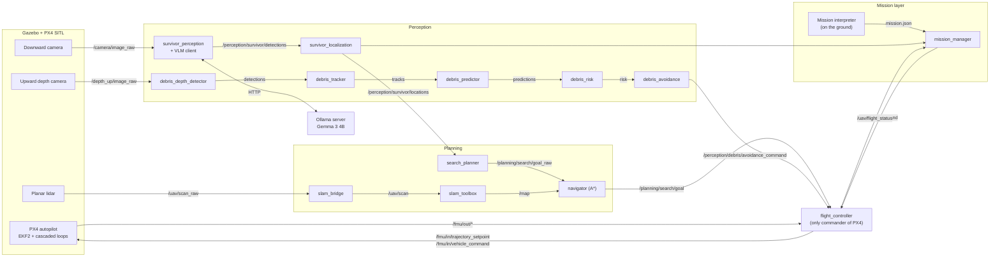

*Figure 1. ROS 2 node graph of the complete mission. The search planner's goal is remapped to
`/planning/search/goal_raw` when the navigator runs, so the navigator can route it around obstacles
(`scripts/mission/run_mission.sh`). Debris topic names are shortened; their full names start with `/perception/debris/`.*

### 4.2 Control layers

The vehicle is controlled by four nested layers. Each layer gives targets only to the layer below it and checks that
layer's feedback before it moves on.

| Layer | Runs in | Rate | Input → output | Feedback used |
|---|---|---|---|---|
| 4. Mission supervision | `mission_manager_node.py`, `mission_logic.py` | 2 Hz | mission file → START / RETURN_HOME / LAND_NOW | flight status, perception health, battery, VLM availability |
| 3. Supervisory flight controller | `flight_controller.py` | 20 Hz | goals and avoidance proposals → one position setpoint | PX4 position, arming and navigation state, landed flag, telemetry age |
| 2. Position and velocity loops | PX4 `mc_pos_control` | PX4 internal | position setpoint → thrust vector and attitude setpoint | EKF2 position and velocity |
| 1. Attitude, rate loops and mixer | PX4 `mc_att_control`, `mc_rate_control`, control allocator | PX4 internal | attitude setpoint → 4 motor commands | gyro, attitude estimate |

In MuJoCo, layers 1–2 are the project's own cascaded controller (`simulation/mujoco/controllers/quadrotor.py`) and
layers 3–4 are a Python mission loop (`simulation/mujoco/scripts/run_mission.py`).

---

## 5. Mission Workflow

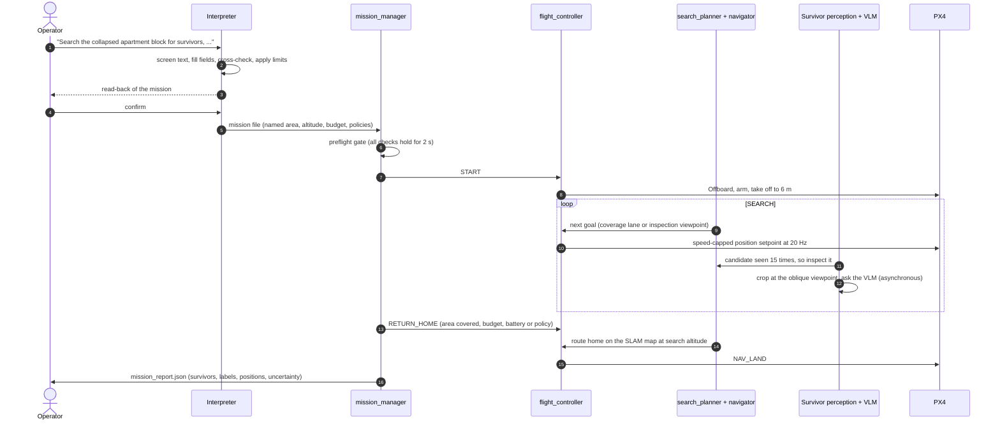

*Figure 2. One complete mission, from the English instruction to the written report.*

---

## 6. Methods and Mathematics

All equations in this section are implemented in the named source files, unless they are marked
**[evaluation only]** (computed offline against simulator truth) or **[background]** (textbook theory that explains an
implemented model).

### 6.1 Notation and frames

| Frame | Axes | Used by |
|---|---|---|
| Gazebo world | x east, y north, z up (ENU) | simulator, ground-truth logs |
| PX4 local | north, east, down (NED), origin at the takeoff point | all estimates and all planning |
| Body (PX4) | forward, right, down (FRD) | PX4 attitude quaternion |
| Sensor | X along the optical axis, Y image-left, Z image-up | both cameras |

Bold lower-case symbols are column vectors and bold upper-case symbols are matrices. In the PX4 local frame a higher
altitude means a *more negative* <i>z</i>. <b>R</b> always denotes the body-to-local rotation matrix and
<b>e</b><sub><i>z</i></sub> = (0, 0, 1)<sup>T</sup>.

### 6.2 Vehicle model and control allocation

The x500 parameters come from the PX4 `x500` model and are used identically in MuJoCo.

| Quantity | Symbol | Value |
|---|---|---|
| Mass | <i>m</i> | 2.064 kg |
| Inertia | <i>J</i><sub><i>x</i><i>x</i></sub>, <i>J</i><sub><i>y</i><i>y</i></sub>, <i>J</i><sub><i>z</i><i>z</i></sub> | 0.02167, 0.02167, 0.040 kg·m² |
| Rotor thrust constant | <i>k</i><sub><i>f</i></sub> | 8.54858 × 10<sup>−6</sup> N/(rad/s)², <i>ω</i><sub>max</sub> = 1000 rad/s |
| Maximum thrust | <i>T</i><sub>max</sub> | 8.55 N per rotor, 34.2 N total |
| Weight | <i>m</i><i>g</i> | 20.25 N (hover needs 59 % of <i>T</i><sub>max</sub>) |
| Thrust-to-weight ratio | <i>T</i><sub>max</sub>/<i>m</i><i>g</i> | 1.69 |
| Motor time constant | | 0.0125 s spin-up, 0.025 s spin-down |
| Reaction-torque coefficient | <i>k</i><sub><i>m</i></sub> | 0.016 m |

### 6.3 Linearisation and controllability

With state <b>x</b> = [<i>x</i>, <i>y</i>, <i>z</i>, <i>v</i><sub><i>x</i></sub>, <i>v</i><sub><i>y</i></sub>, <i>v</i><sub><i>z</i></sub>, <i>φ</i>, <i>θ</i>, <i>ψ</i>, <i>p</i>, <i>q</i>, <i>r</i>]<sup>T</sup> (position, velocity, roll, pitch,
yaw and body rates) and input <b>u</b> = [<i>Δ</i><i>T</i>, <i>τ</i><sub><i>x</i></sub>, <i>τ</i><sub><i>y</i></sub>, <i>τ</i><sub><i>z</i></sub>]<sup>T</sup>, the small-angle model about hover
(<i>T</i> = <i>m</i><i>g</i>) is

$$
\dot{x} = v_x,\quad \dot{y} = v_y,\quad \dot{z} = v_z,\quad
\dot{v}_x = g\,\theta,\quad \dot{v}_y = -g\,\phi,\quad \dot{v}_z = \frac{\Delta T}{m},
$$

$$
\dot{\phi} = p,\quad \dot{\theta} = q,\quad \dot{\psi} = r,\quad
\dot{p} = \frac{\tau_x}{J_{xx}},\quad \dot{q} = \frac{\tau_y}{J_{yy}},\quad \dot{r} = \frac{\tau_z}{J_{zz}},
$$

that is <b>ẋ</b> = <b>A</b><b>x</b> + <b>B</b><b>u</b>, where <i>Δ</i><i>T</i> is the thrust deviation from
hover. Each horizontal axis is a fourth-order chain (torque → rate → angle → acceleration <i>g</i><i>θ</i> → velocity →
position).

Two standard tests were applied, the Kalman rank test and the Popov–Belevitch–Hautus (PBH) test [[8]](#ref-8), where <i>n</i> is the number of states:

$$
\text{Kalman:}\ \mathrm{rank}\big[\mathbf{B}\ \ \mathbf{A}\mathbf{B}\ \ \mathbf{A}^2\mathbf{B}\ \cdots\ \mathbf{A}^{n-1}\mathbf{B}\big] = n,
\qquad
\text{PBH:}\ \mathrm{rank}\big[\lambda\mathbf{I} - \mathbf{A}\ \ \ \mathbf{B}\big] = n\ \ \text{for every eigenvalue}\ \lambda\ \text{of}\ \mathbf{A}.
$$

| Model | States | Inputs | Kalman rank | PBH rank | Result |
|---|---|---|---|---|---|
| Rigid body, <b>u</b> = [<i>Δ</i><i>T</i>, <i>τ</i><sub><i>x</i></sub>, <i>τ</i><sub><i>y</i></sub>, <i>τ</i><sub><i>z</i></sub>] | 12 | 4 | 12 | 12 | controllable |
| Rigid body, <b>u</b> = 4 rotor thrusts through <b>A</b><sub>alloc</sub> | 12 | 4 | 12 | 12 | controllable |
| Rigid body + first-order motor lag | 16 | 4 | 4 \* | 16 | controllable |
| Horizontal chain [<i>x</i>, <i>v</i><sub><i>x</i></sub>, <i>θ</i>, <i>q</i>], <i>u</i> = <i>τ</i><sub><i>y</i></sub> | 4 | 1 | 4 | 4 | controllable |
| Counter-example: thrust only, no torques | 12 | 1 | 2 | 9 | **not controllable** |

\* The 16-state Kalman matrix contains powers of the 80 s⁻¹ motor pole up to 80<sup>15</sup> ≈ 3.5 × 10<sup>28</sup>,
which swamp the other columns, so the numerical rank is understated. The PBH test, which stays numerically reliable,
shows full rank, as expected: an invertible first-order lag in front of a controllable system keeps it controllable.

**Interpretation.** With four independent rotors the linearised x500 can reach any position, velocity, attitude and
rate, even though it has no direct horizontal actuator: horizontal motion is reached *through attitude*. The
counter-example shows why torques are essential: thrust alone moves only <i>z</i> and <i>v</i><sub><i>z</i></sub>. Controllability holds for the
linear model at hover only. It says nothing about stability (§6.4), large angles, or saturation of the 1.69
thrust-to-weight ratio.

### 6.4 Inner loops and closed-loop stability

**PX4 inner loops [background]** (default gains, unchanged in this project):

| Loop | Law | PX4 parameters |
|---|---|---|
| Position | <b>v</b><sub><i>s</i><i>p</i></sub> = <i>K</i><sub><i>p</i></sub>(<b>p</b><sub><i>s</i><i>p</i></sub> − <b>p</b>) | `MPC_XY_P` = 0.95, `MPC_Z_P` = 1.0 |
| Velocity | PID → acceleration and thrust vector | `MPC_XY_VEL_P/I/D_ACC` = 1.8 / 0.4 / 0.2 |
| Attitude | P on the quaternion error | `MC_ROLL_P` = `MC_PITCH_P` = 4.0, `MC_YAW_P` = 2.8 |
| Body rate | PID | `MC_ROLLRATE_P/I/D` = 0.15 / 0.2 / 0.003 |
| Limits | | 12 m/s horizontal, 3 m/s up, 1.5 m/s down, 45° tilt |

Here <b>p</b><sub><i>s</i><i>p</i></sub> is the position setpoint, <b>v</b><sub><i>s</i><i>p</i></sub> the resulting velocity setpoint, and <i>K</i><sub><i>p</i></sub> the
position gain.

**Fitted PX4 response model.** For the debris planner (§6.10), PX4's horizontal response was fitted to recorded flights
(133 start states, largest 1 s-ahead error 0.25 m) as, per axis,

$$
\dot{a} = \frac{\mathrm{clip}\big(k_v\,(\mathrm{clip}(k_p\,e,\ v_{\max}) - v),\ a_{\max}\big) - a}{\tau}
$$

with position error <i>e</i>, velocity <i>v</i>, acceleration <i>a</i>, attitude lag <i>τ</i> = 0.493 s, <i>k</i><sub><i>p</i></sub> = 0.827 s<sup>−1</sup>,
<i>k</i><sub><i>v</i></sub> = 3.203 s<sup>−1</sup> and <i>a</i><sub>max</sub> = 11.08 m/s<sup>2</sup>. Without saturation, the closed loop has the
characteristic polynomial

$$
\tau s^3 + s^2 + k_v s + k_v k_p = 0 .
$$

| Loop | Eigenvalues (s⁻¹) | Least-damped mode | Rise 10–90 % (1 m step) | Overshoot | 2 % settling |
|---|---|---|---|---|---|
| MuJoCo, horizontal (5 states incl. integrator) | −11.50; −2.97 ± 2.81j; −2.40; −0.155 | ζ = 0.73, ωₙ = 4.1 rad/s | 1.04 s | 0 % | 2.06 s |
| MuJoCo, vertical (with motor lag) | −76.7; −1.56 ± 1.12j; −0.155 | ζ = 0.81, ωₙ = 1.9 rad/s | 1.33 s | 0.8 % | 2.07 s |
| PX4, horizontal (fitted model above) | −0.98; −0.52 ± 2.28j | ζ = 0.22, ωₙ = 2.3 rad/s | 1.10 s | 2.7 % | 5.07 s |

Here ζ is the damping ratio and ωₙ the natural frequency. All eigenvalues have negative real parts, so every loop is
asymptotically stable about hover. The pole at −0.155 s⁻¹ is the slow velocity integrator of the MuJoCo controller,
which removes steady offsets such as rotor drag. The PX4 fit is lightly damped because it was fitted for 1 s-ahead
prediction, not as a gain design.

### 6.5 Supervisory flight controller

`flight_controller.py` is a supervisory, setpoint-based controller: it implements no PID loop itself. It closes the loop
*logically*, testing PX4 feedback before every state transition, and is the only node that publishes to the PX4 Offboard interface [[11]](#ref-11):
`/fmu/in/offboard_control_mode`, `/fmu/in/trajectory_setpoint` and `/fmu/in/vehicle_command`.

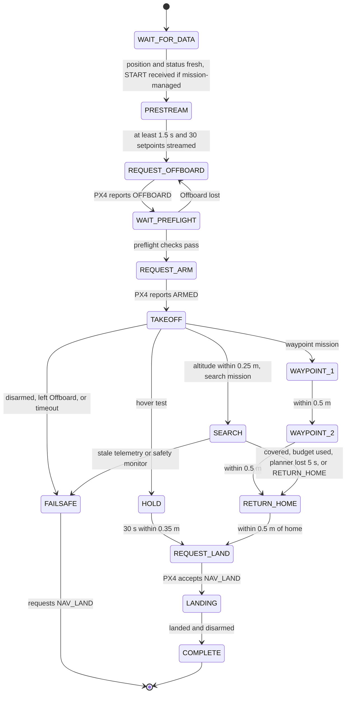

*Figure 3. Flight-controller state machine. Every state also moves to FAILSAFE on a timeout or a guard violation.*

| Guard | Value |
|---|---|
| Control tick and setpoint rate | 0.05 s (20 Hz) |
| Command retry interval and attempts | 2.0 s, at most 4 attempts |
| Telemetry freshness (position, status) | 1.0 s by default (`position_timeout_s`, `status_timeout_s`; raised to 3.0 s / 8.0 s in the CPU-VLM demo) |
| Offboard, preflight and arming timeouts | 15 s, 30 s, 15 s |
| Takeoff | 3 m default (6 m in the urban missions), tolerance 0.25 m, timeout 30 s |
| Waypoint arrival | radius 0.5 m, timeout 45 s |
| Landing | NAV_LAND accepted, then landed and disarmed within 45 s |
| Every airborne state | PX4 disarmed or left Offboard → FAILSAFE |

**Setpoint arbitration.** Each tick the controller selects exactly one target:

$$
\mathbf{p}_{\mathrm{cmd}} =
\begin{cases}
\mathbf{p}_{\mathrm{avoid}}, & \text{if an avoidance proposal is active and passes validation} \\
\mathrm{limit}\big(\mathbf{p},\ \mathbf{p}_{\mathrm{mission}},\ v_{\mathrm{lim}}\big), & \text{otherwise}
\end{cases}
$$

An avoidance proposal <b>p</b><sub>avoid</sub> is accepted only if it is younger than 0.5 s, finite, at most
6 m from the vehicle, and between 1.5 m and 15 m above the takeoff point (`avoidance_interface.py`). While it is active,
the mission step's timers are frozen.

**Speed cap through the setpoint.** PX4's position loop commands <b>v</b> = <i>K</i><sub><i>p</i></sub>&#8201;<b>e</b>, so a horizontal speed
limit <i>v</i><sub>lim</sub> is enforced without changing PX4 by never placing the setpoint further than
<i>v</i><sub>lim</sub>/<i>K</i><sub><i>p</i></sub> ahead of the vehicle:

$$
\mathbf{p}_{\mathrm{cmd},xy} =
\begin{cases}
\mathbf{p}_{\mathrm{mission},xy}, & \lVert \mathbf{e}_{xy} \rVert \le v_{\mathrm{lim}}/K_p \\
\mathbf{p}_{xy} + \dfrac{v_{\mathrm{lim}}/K_p}{\lVert \mathbf{e}_{xy} \rVert}\,\mathbf{e}_{xy}, & \text{otherwise}
\end{cases}
\qquad
\mathbf{e}_{xy} = \mathbf{p}_{\mathrm{mission},xy} - \mathbf{p}_{xy}
$$

where <b>p</b><sub><i>x</i><i>y</i></sub> is the current horizontal position and <i>K</i><sub><i>p</i></sub> = 0.95 s<sup>−1</sup> is PX4's `MPC_XY_P`. The cap
is the minimum of the transit limit, the search speed (2.0 m/s; inspection 1.5 m/s; never above 3.0 m/s), and any lower
cap the debris planner requests when perception degrades (never below 0.5 m/s). Search goals are accepted only if
younger than 1.0 s and within 25 m of home (`search_interface.py`).

### 6.6 Debris detection

**Camera model** (`debris_detection.py`; pinhole, no distortion). A point (<i>X</i>, <i>Y</i>, <i>Z</i>) in the sensor frame projects to
pixel (<i>u</i>, <i>v</i>), and a pixel with axial depth <i>d</i> back-projects to <b>p</b><sub><i>s</i></sub>:

$$
u = c_x - f_x\frac{Y}{X},\qquad v = c_y - f_y\frac{Z}{X},\qquad
f_x = f_y = \frac{W/2}{\tan(\mathrm{HFOV}/2)},\qquad
\mathbf{p}_s = \Big(d,\ -\frac{(u - c_x)\,d}{f_x},\ -\frac{(v - c_y)\,d}{f_y}\Big)
$$

where (<i>c</i><sub><i>x</i></sub>, <i>c</i><sub><i>y</i></sub>) is the principal point and <i>W</i> the image width. For the upward depth camera (<i>W</i> = 640,
HFOV = 100°) this gives <i>f</i> = 268.51 px; for the downward camera (<i>W</i> = 1280, HFOV = 1.74 rad), <i>f</i> = 539.9 px.

The point is moved to the body frame (sensor 0.15 m above `base_link`) and then to the PX4 local frame with the attitude
quaternion <b>q</b> and position <b>p</b><sub>uav</sub> **interpolated to the image timestamp**:
<b>p</b><sub>NED</sub> = <b>R</b>(<b>q</b>)&#8201;<b>p</b><sub>FRD</sub> + <b>p</b><sub>uav</sub>.
Valid pixels (depth 0.5–35 m) are grouped into 8-connected components, split at depth jumps over 0.30 m, gated by size,
and filtered against static structure.

### 6.7 Debris tracking

`debris_tracking.py` runs one Kalman filter [[5]](#ref-5) per object with state
<b>x</b> = [<i>p</i><sub><i>x</i></sub>, <i>p</i><sub><i>y</i></sub>, <i>p</i><sub><i>z</i></sub>, <i>v</i><sub><i>x</i></sub>, <i>v</i><sub><i>y</i></sub>, <i>v</i><sub><i>z</i></sub>]<sup>T</sup> in the local NED frame. Gravity is a known input, not a state:

$$
\mathbf{x}^- = \mathbf{F}\mathbf{x} + \mathbf{B}g,\qquad
\mathbf{F} = \begin{bmatrix} \mathbf{I}_3 & \Delta t\,\mathbf{I}_3 \\ \mathbf{0} & \mathbf{I}_3 \end{bmatrix},\qquad
\mathbf{B} = \begin{bmatrix} \tfrac{1}{2}\Delta t^2\,\mathbf{e}_z \\ \Delta t\,\mathbf{e}_z \end{bmatrix},\qquad
\mathbf{P}^- = \mathbf{F}\mathbf{P}\mathbf{F}^\top + \mathbf{Q}
$$

$$
\mathbf{y} = \mathbf{z} - \mathbf{H}\mathbf{x}^-,\quad
\mathbf{S} = \mathbf{H}\mathbf{P}^-\mathbf{H}^\top + \mathbf{R}_m,\quad
\mathbf{K} = \mathbf{P}^-\mathbf{H}^\top\mathbf{S}^{-1},\quad
\mathbf{x} = \mathbf{x}^- + \mathbf{K}\mathbf{y},\quad
\mathbf{P} = (\mathbf{I} - \mathbf{K}\mathbf{H})\,\mathbf{P}^-
$$

| Symbol | Meaning | Value |
|---|---|---|
| <i>Δ</i><i>t</i> | difference of consecutive sensor timestamps | measured, not assumed |
| <i>g</i> | gravity (down is +<i>z</i> in NED) | 9.8 m/s² |
| <b>Q</b> | process noise from white-noise acceleration (below) | <i>σ</i><sub><i>a</i></sub> = 3 m/s² |
| <b>z</b>, <b>H</b> | measured centroid of the visible surface, <b>H</b> = [<b>I</b><sub>3</sub>  <b>0</b>] | |
| <b>R</b><sub><i>m</i></sub> | measurement noise <i>σ</i><sub><i>m</i></sub><sup>2</sup><b>I</b><sub>3</sub> | <i>σ</i><sub><i>m</i></sub> = 0.10 m (0.30 m when cut by the image border) |
| <b>y</b>, <b>S</b>, <b>K</b> | innovation, its covariance, Kalman gain | |

For each axis, the process noise block acting on (position, velocity) is

$$
\mathbf{Q}_{\mathrm{axis}} = \sigma_a^2 \begin{bmatrix} \Delta t^4/4 & \Delta t^3/2 \\ \Delta t^3/2 & \Delta t^2 \end{bmatrix}.
$$

**Association.** Detections are matched to tracks by the Hungarian algorithm [[7]](#ref-7)
(`scipy.optimize.linear_sum_assignment`) on the Mahalanobis cost
<i>c</i><sub><i>i</i><i>j</i></sub> = <b>y</b><sub><i>i</i><i>j</i></sub><sup>T</sup> <b>S</b><sub><i>i</i><i>j</i></sub><sup>−1</sup><b>y</b><sub><i>i</i><i>j</i></sub>. A pair is allowed only if <i>c</i><sub><i>i</i><i>j</i></sub> < 16.27 (the
99.9 % <i>χ</i><sup>2</sup> quantile with 3 degrees of freedom). A track is confirmed after 3 measurements spanning at least 0.10 m,
and deleted after 6 missed frames or 1.0 s.

### 6.8 Trajectory prediction

`debris_prediction.py` propagates each track ballistically to horizons <i>h</i> ∈ { 0.1, 0.25, 0.5, 0.75, 1.0, 1.5, 2.0 } s:

$$
\mathbf{p}(t + h) = \mathbf{p} + \mathbf{v}\,h + \tfrac{1}{2}\,\mathbf{a}\,h^2,\qquad
\mathbf{v}(t + h) = \mathbf{v} + \mathbf{a}\,h,\qquad
\mathbf{P}(h) = \mathbf{F}(h)\,\mathbf{P}\,\mathbf{F}(h)^\top + \mathbf{Q}(h)
$$

with <b>a</b> = (0, 0, <i>g</i>) for the default ballistic model. Constant-velocity (<b>a</b> = <b>0</b>) and
constant-acceleration (least-squares slope of the track's velocity over 0.4 s) models are implemented for comparison
but not used, because a constant-velocity prediction of a falling body is wrong by exactly ½&#8201;<i>g</i><i>h</i><sup>2</sup> in
position (4.9 m at <i>h</i> = 1 s). Drag, bounce and sliding are not modelled.

### 6.9 Collision risk

`debris_risk.py` evaluates the relative position <b>r</b>(<i>h</i>) = <b>p</b><sub>debris</sub>(<i>t</i> + <i>h</i>) − <b>p</b><sub>uav</sub>(<i>t</i> + <i>h</i>),
with the UAV extrapolated at constant velocity, every 0.01 s up to 2 s:

$$
d_{\min} = \min_{h}\ \lVert \mathbf{r}(h) \rVert,\qquad
t_{ca} = \arg\min_{h}\ \lVert \mathbf{r}(h) \rVert,\qquad
\sigma_r = \sqrt{\mathbf{u}^\top\mathbf{P}_{\mathrm{pos}}\,\mathbf{u}},\qquad
d_{\mathrm{cons}} = d_{\min} - \min\big(\sigma_r,\ 0.10 + 0.40\,t_{ca}\big)
$$

where <b>u</b> = <b>r</b>/‖<b>r</b>‖ at closest approach and <b>P</b><sub>pos</sub> is the
predicted position covariance. The cap 0.10 + 0.40&#8201;<i>t</i><sub><i>c</i><i>a</i></sub> (metres) is an envelope fitted to the measured prediction
error, because the filter covariance is too wide at long horizons.

With debris radius <i>ρ</i> = 0.71 × box size, the contact radius is <i>r</i><sub><i>c</i></sub> = 0.40 + <i>ρ</i> (the x500 arm plus propeller,
rounded up) and the safety radius is <i>r</i><sub><i>s</i></sub> = <i>r</i><sub><i>c</i></sub> + 0.30 m (0.68 m and 0.98 m for a 0.4 m box).

| State | Condition |
|---|---|
| CRITICAL | <i>d</i><sub>min</sub> < <i>r</i><sub><i>c</i></sub>, or <i>d</i><sub>min</sub> < <i>r</i><sub><i>s</i></sub> with <i>t</i><sub><i>c</i><i>a</i></sub> ≤ 0.75 s |
| WARNING | <i>d</i><sub>min</sub> < <i>r</i><sub><i>s</i></sub> with <i>t</i><sub><i>c</i><i>a</i></sub> > 0.75 s |
| WATCH | <i>d</i><sub>cons</sub> < <i>r</i><sub><i>s</i></sub> |
| SAFE | otherwise |
| POTENTIAL_THREAT | unconfirmed track faster than 2 m/s whose free-fall path enters <i>r</i><sub><i>s</i></sub> |

### 6.10 Debris avoidance planning

`debris_avoidance.py` is a sampling-based model-predictive planner:

1. **Candidates:** hold; 8 horizontal directions × {2.5 m, 4.0 m}; climb 2.0 m; descend 1.0 m; plus the setpoint
   currently flown.
2. **Roll-out:** each candidate is simulated for 2 s at 20 ms steps through the fitted response model of §6.4
   (horizontal: <i>τ</i> = 0.493 s, <i>k</i><sub><i>p</i></sub> = 0.827, <i>k</i><sub><i>v</i></sub> = 3.203, <i>a</i><sub>max</sub> = 11.08 m/s²; vertical: <i>τ</i> = 0.02 s,
   <i>k</i><sub><i>p</i></sub> = 1.181, <i>k</i><sub><i>v</i></sub> = 12.0, <i>a</i><sub>max</sub> = 6.75 m/s²).
3. **Hard constraints:** a candidate is rejected if at any sampled time its separation from any predicted debris path
   is below <i>r</i><sub><i>s</i></sub> + margin(<i>t</i>) + 0.25 m (the model error), or it leaves 1.5–12 m altitude, exceeds 5.0 m/s
   horizontally or 2.5 m/s vertically, or enters a structure.
4. **Cost:** the cheapest feasible candidate is proposed:

$$
J = w_{\mathrm{risk}}\,\mathrm{risk} + w_{\mathrm{dist}}\,\mathrm{deviation} + w_{\mathrm{energy}}\,\mathrm{effort}
  + w_{\mathrm{smooth}}\,\mathrm{change} + w_{\mathrm{alt}}\,\Delta h
$$

| Term | Definition | Weight |
|---|---|---|
| risk | clip(1 − <i>c</i>/1.5 m, 0, 1), where <i>c</i> is the smallest clearance (separation minus requirement) | <i>w</i><sub>risk</sub> = 10 |
| deviation | distance of the setpoint from the nominal path (m) | <i>w</i><sub>dist</sub> = 1.0 |
| effort | distance of the setpoint from the present position (m) | <i>w</i><sub>energy</sub> = 0.5 |
| change | distance from the setpoint currently flown (m) | <i>w</i><sub>smooth</sub> = 0.5 |
| <i>Δ</i><i>h</i> | difference between setpoint and mission altitude (m) | <i>w</i><sub>alt</sub> = 0.5 |

The planner's state machine is NORMAL_FLIGHT → PREPARE_AVOIDANCE → AVOIDING → CLEARING → RESUME_MISSION (plus DEFENSIVE
and AVOIDANCE_FAILSAFE). The result is only a *proposal*: `flight_controller` validates it (§6.5).

### 6.11 Flight safety monitor

`flight_safety.py` checks every PX4 position sample above 0.5 m altitude; any violation latches FAILSAFE and requests
PX4 `NAV_LAND`. Here <b>a</b> is acceleration, <i>Δ</i><b>p</b> and <i>Δ</i><b>v</b> are the changes between
samples <i>Δ</i><i>t</i> apart, and <b>v̄</b> their mean velocity:

$$
\begin{aligned}
\text{impact:}\quad & \lVert \mathbf{a} \rVert > 30\ \mathrm{m/s^2} \\
\text{position jump:}\quad & \lVert \Delta\mathbf{p} - \bar{\mathbf{v}}\,\Delta t \rVert > 0.5 + \tfrac{1}{2}(30)\,\Delta t^2\ \mathrm{m} \\
\text{velocity jump:}\quad & \lVert \Delta\mathbf{v} \rVert > 3.0 + 30\,\Delta t\ \mathrm{m/s} \\
\text{speed envelope:}\quad & v_{xy} > 6.5\ \mathrm{m/s}\ \ \text{or}\ \ \lvert v_z \rvert > 3.0\ \mathrm{m/s}
\end{aligned}
$$

It also trips on an estimator reset, any non-finite value, or an altitude excursion over 1.0 m in cruise states.

### 6.12 Coverage search planning

`search_planning.py` sizes the lanes from the downward camera's ground footprint. At height <i>h</i> above the plane of
interest (flight altitude minus the 0.9 m target height), with usable-image margin <i>m</i> = 0.8 and image size
<i>W</i> × <i>H</i>, the footprint half-extents (forward <i>ℓ</i><sub><i>f</i></sub>, right <i>ℓ</i><sub><i>r</i></sub>) are

$$
(\ell_f,\ \ell_r) = m\,h\left(\frac{H/2}{f_y},\ \frac{W/2}{f_x}\right),\qquad
s = 2\,\ell_{\perp}\,(1 - \omega),\qquad
n_{\mathrm{lanes}} = \left\lceil \frac{w}{s} \right\rceil
$$

where <i>ℓ</i><sub>⊥</sub> is the across-lane half-extent, <i>ω</i> = 0.5 the overlap between neighbouring swaths, <i>s</i> the lane
spacing and <i>w</i> the area width. With 50 % overlap, every ground point is imaged from two lanes. A 0.5 m grid records
which cells the real footprint (from the real pose) has covered:
coverage = #{cells seen} / #{cells in the area}.

**Inspection.** When a candidate has been observed at least 15 times, the planner leaves the lanes and flies
**2 viewpoints, 90° apart, 2–4 m from the candidate and about 35° off nadir**, at 1.5 m/s. These oblique views give the
VLM a complete side view (it rejects straight-down crops) and give the localiser a triangulation baseline.

### 6.13 SLAM and path planning

**SLAM.** `slam_toolbox` [[2]](#ref-2) builds a 2-D pose-graph map with scan matching and loop closure from the planar
lidar. `slam_bridge` levels each scan with the vehicle attitude and keeps only returns within the 6 m flight plane.

**A\* planning** [[6]](#ref-6) (`navigation.py`) runs on a 0.5 m grid built from the SLAM map. With <i>c</i><sub><i>i</i></sub> the clearance
of cell <i>i</i> to the nearest mapped obstacle:

$$
\text{cost}_i = 1 + w_c\,\mathrm{clip}\left(1 - \frac{c_i - r_{\mathrm{inf}}}{r_{\mathrm{caution}} - r_{\mathrm{inf}}},\ 0,\ 1\right)\Big|_{c_i < r_{\mathrm{caution}}}
+ c_{\mathrm{unknown}}\Big|_{i\ \text{unobserved}},
\qquad
g(\text{route}) = \sum_{\text{steps}} \text{cost}_i \times \text{step length}
$$

| Symbol | Meaning | Value |
|---|---|---|
| <i>r</i><sub>inf</sub> | inflation radius: cells with <i>c</i><sub><i>i</i></sub> < <i>r</i><sub>inf</sub> are blocked | 1.75 m |
| <i>r</i><sub>caution</sub> | cells closer than this cost more | 4.0 m |
| <i>w</i><sub><i>c</i></sub> | caution weight | 3.0 |
| <i>c</i><sub>unknown</sub> | extra cost of a never-observed cell | 0.6 |

The heuristic is the Euclidean distance to the goal, and moves are 8-connected. A 3.5 m look-ahead point on the route is
sent as the goal; the route is replanned every 1 s, and the speed drops to 1.2 m/s within 3 m of obstacles. The **return
home is routed on the SLAM map at search altitude**; the vehicle climbs only near home, because a straight
climb-and-return under slabs caused an impact during development.

### 6.14 Survivor detection and VLM verification

1. **Candidate detector** (`survivor_detection.py`, simulation baseline): HSV masks for clothing (orange), head (skin
   tone) and legs (blue), plus a shape test, combined into a confidence
   <i>c</i> = 0.30 + 0.35&#8201;[head] + 0.20&#8201;[shape] + 0.15&#8201;[legs], where [·] is 1 if the cue is
   present and 0 otherwise. A confidence of at least 0.55 is a strong candidate.
2. **Temporal confirmation** (`survivor_confirmation.py`): a candidate must appear in at least 5 of the last 8 frames.
3. **VLM** (`vlm_client.py`, Gemma 3 4B [[3]](#ref-3) through Ollama's OpenAI-compatible API): a padded crop is sent
   **asynchronously** from a worker thread, so flight control never waits. The question is asked in two steps (a
   neutral description first, then "is this a person?"), because a direct question made small models answer yes, or
   no, to everything. In the urban missions, requests are made only while inspecting, with at most 3 answers per track.

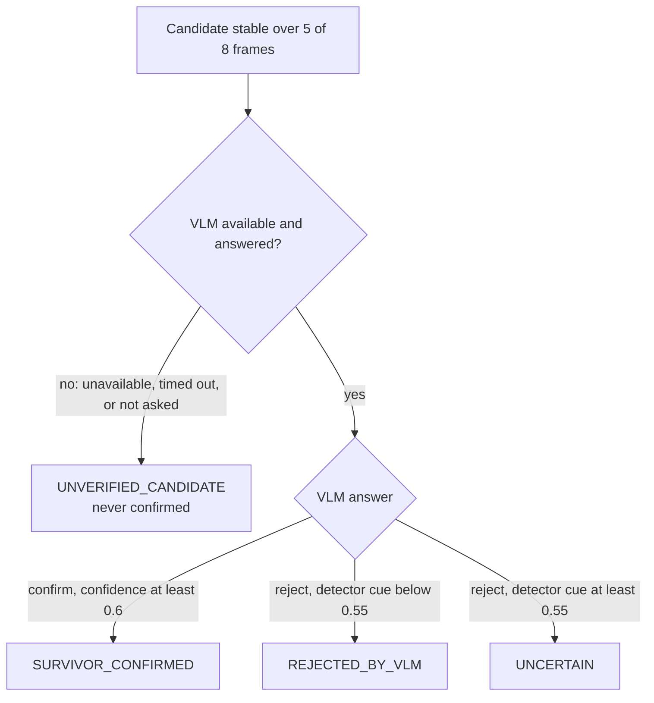

*Figure 4. Decision rule for each survivor track. Without a working VLM the system cannot confirm a survivor.*

### 6.15 Survivor 3-D localisation

`survivor_localization.py` estimates each survivor as a static 3-D point <b>p</b> with an extended Kalman filter.
With camera centre <b>c</b> and rotation <b>R</b> taken from PX4's estimate at the image time, the point in the
camera body frame and the measurement model are

$$
\mathbf{b} = \mathbf{R}^\top(\mathbf{p} - \mathbf{c}) = (x_b,\ y_b,\ z_b),\qquad
h(\mathbf{p}) = \begin{bmatrix} c_x + f_x\,y_b / z_b \\ c_y - f_y\,x_b / z_b \end{bmatrix},\qquad
\mathbf{H} = \frac{\partial h}{\partial \mathbf{b}}\,\mathbf{R}^\top \in \mathbb{R}^{2 \times 3}
$$

where <i>z</i><sub><i>b</i></sub> is the depth along the optical axis. Because the point is static, the prediction step is the identity.
Observations whose innovation fails the 99.9 % <i>χ</i><sup>2</sup> gate with 2 degrees of freedom (13.8) are rejected.

**Initialisation.** The first ray <b>r</b> is intersected with a horizontal plane at an assumed target height of
0.9 m above the ground (<i>z</i><sub>plane</sub> in NED):

$$
\mathbf{p}_0 = \mathbf{c} + s\,\mathbf{r},\qquad s = \frac{z_{\mathrm{plane}} - c_z}{r_z}\qquad (r_z > 0,\ s > 0)
$$

The uncertainty along the ray starts large (<i>σ</i> = 0.6 m on the height). Once the drone has moved, rays from
different viewpoints triangulate the point, and the height assumption stops mattering. The least-squares ray
intersection solves

$$
\Big[\sum_i \big(\mathbf{I} - \mathbf{r}_i\mathbf{r}_i^\top\big)\Big]\,\mathbf{p}
= \sum_i \big(\mathbf{I} - \mathbf{r}_i\mathbf{r}_i^\top\big)\,\mathbf{c}_i
$$

and is rejected if the condition number of the left-hand matrix exceeds 10<sup>9</sup> (nearly parallel rays). A 0.2 m
systematic floor is added to the reported covariance. Ground truth is never used.

### 6.16 Mission from one sentence

`mission_language.py` turns an instruction into a mission in five checked steps:

1. **Text screen:** refuses empty text, requests to ignore or disable safety, and imperial or hour units.
2. **Interpreter:** keyword rules (default) or a language model fills a fixed set of ten fields: `task`, `place`,
   `altitude_m`, `time_limit_s`, `stop_when`, `avoid_debris`, `confirmed_only`, `battery_return_percent`, `unclear` and
   `priority_place`. It **cannot output coordinates**: a place is always a named area from a catalogue
   (`missions/places_disaster.json`; for example `collapsed_block` = north 44–72 m, east 14–27 m, at 6 m).
3. **Cross-checks:** every number must appear in the text, the place must be named, and safety flags are combined
   with logical OR.
4. **Limits:** out-of-range altitude, time or area is refused, never clamped.
5. **Read-back:** the operator confirms before anything flies.

"Only report confirmed ones" sets `require_vlm`, so the mission **will not take off** without a working VLM. The
mission manager's preflight gate requires, for 2 s: the controller waiting, perception streams younger than 2 s, the
planner alive, the VLM available (if required), debris avoidance alive (if required), and battery at least the return
level plus 10 %.

---

## 7. Simulation Environments

### 7.1 Collapsed-building world (Gazebo)

Used for the debris and survivor studies (Phases 0–7).

| File | Description |
|---|---|
| `src/uav_autonomy/worlds/collapsed_building_rescue.sdf` | building with broken walls, a roof opening, fallen concrete, rubble and a survivor manikin |
| `src/uav_autonomy/worlds/depth_validation.sdf` | empty world for depth-camera calibration |
| `src/uav_autonomy/worlds/survivor_variants/` | `occluded`, `rubble`, `outdoor`, `none`, `multi`, `distractors` variants for survivor tests |
| `src/uav_autonomy/models/x500_rescue/` | PX4 x500 with the downward camera and the upward depth camera |

<p align="center">
  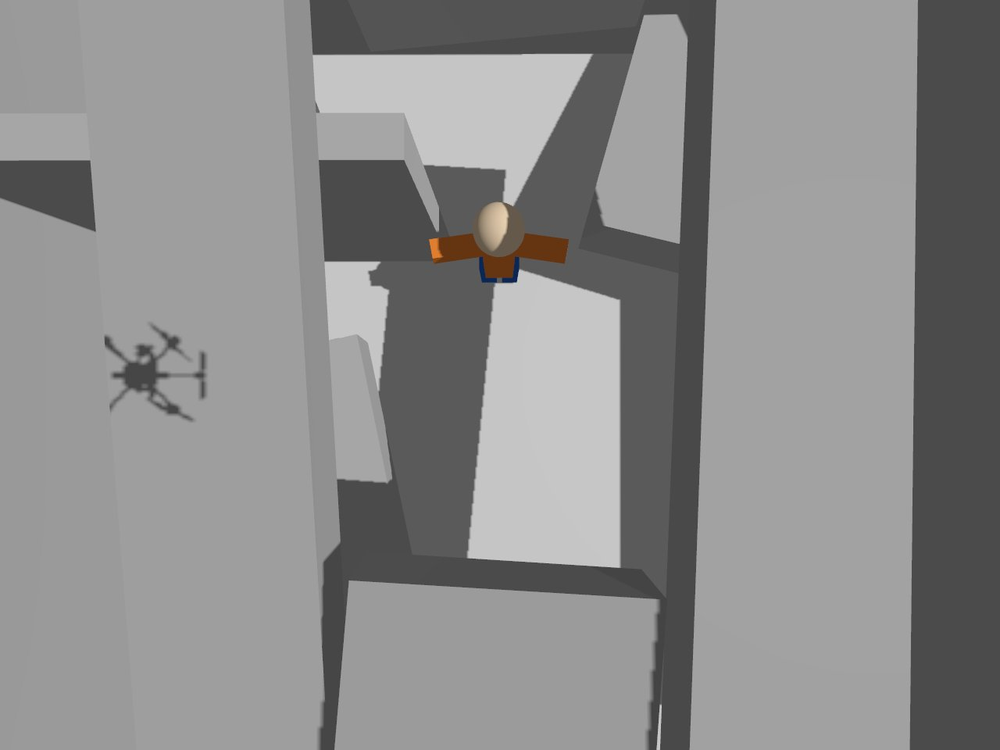
</p>

*Figure 5. Downward camera view inside the collapsed-building world: the x500's shadow (left) and the survivor manikin
(orange clothing, skin-tone head, blue legs) on a broken floor slab.*

### 7.2 Urban earthquake-collapse world

`scripts/disaster/make_disaster_zone.py` procedurally generates a dark urban zone: damaged multi-storey concrete blocks
with exposed floors, a collapsed block with a rubble field, a U-shaped courtyard, and a street blocked by rubble that
forces a detour (about 39 000 triangles). All meshes and textures are generated by project code; no external assets are
used. `scripts/disaster/validate_disaster.py` checks heights (≤ 15 m), rubble (≤ 4.5 m), that the 6 m lidar slice
intersects the structures, that every route a mission needs exists, and that the blocked street really forces a detour.

| Scenario | Content |
|---|---|
| `urban_A` | no survivors (reconnaissance) |
| `urban_B` | one survivor on the collapse rubble (**main demo**) |
| `urban_B2` | one survivor in the courtyard |
| `urban_C` | three survivors and five look-alikes |
| `urban_D` | two survivors partly under leaning slabs, one look-alike |
| `urban_E` | one survivor inside the collapsed block, under a leaning slab |
| `urban_F` | no survivors, five look-alikes (false-positive control) |

Look-alikes (an orange barrel, a cone, a tarp, and a crate with a ball) are designed to fool a colour detector, so they
test the VLM. **Search areas are exterior only**: two early flights into a collapsed interior ended in impacts.

<p align="center">
  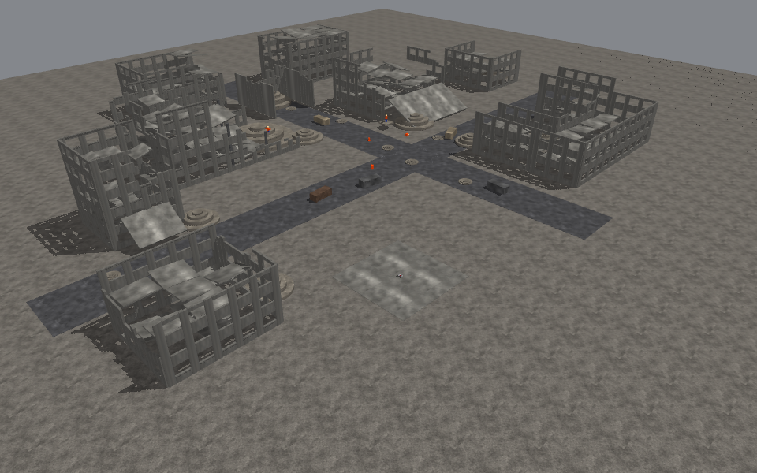
  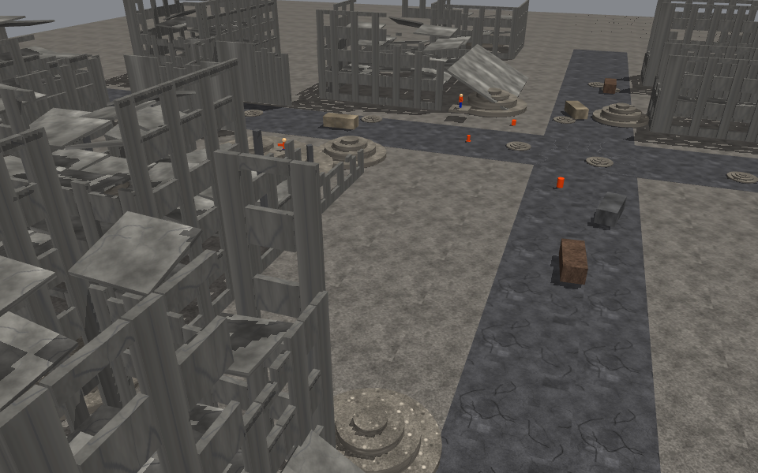
</p>

*Figure 6. The urban collapse world (scenario `urban_C`) rendered in MuJoCo from the same generator: overview (left)
and the collapsed block with the rubble-blocked street (right).*

### 7.3 MuJoCo

`simulation/mujoco/` is an isolated second simulator built on MuJoCo [[4]](#ref-4), [[16]](#ref-16): only the `mujoco` Python package is needed, without ROS, Gazebo
or PX4.

| | Gazebo + PX4 + ROS 2 | MuJoCo |
|---|---|---|
| World | 7 urban scenarios (meshes, shadows) | the same layout as boxes and cylinders, same textures (`make_mujoco_scene.py`) |
| Vehicle | x500 in Gazebo | the same x500 mass, inertia, rotor geometry, thrust and motor lag |
| Autopilot | PX4 SITL (unchanged) | project cascaded controller; optional PX4 in the loop over MAVLink HIL (hover and waypoints) |
| State used by the controller | PX4 EKF2 | simulator state (no noise) |
| Mapping | `slam_toolbox` SLAM | lidar occupancy grid with known pose (not SLAM) |
| Survivor perception | detector, EKF and VLM | the same detector, EKF and VLM, on rendered frames |
| Planning | `search_planning.py`, A* `navigation.py` | the same modules, called directly |
| Falling debris | 6 boxes; the full ROS chain | 3 boxes; the same detector, tracker, risk and planner modules fed by a rendered depth camera |

MuJoCo results are reported separately and are never mixed with Gazebo results.

---

## 8. Results

All results come from simulation. Ground truth was used only offline for scoring. Small samples are reported as counts,
not percentages: for example, 10 successes in 10 flights bound the true success rate below by only about 0.74 (one-sided
95 %).

**Where the evidence is.** Phase 0–7 numbers are summarised, with their sources, in
[`results/final/METRICS_SUMMARY.md`](results/final/METRICS_SUMMARY.md) and the per-phase `README.md` files under
[`results/final/`](results/final/). MuJoCo mission reports are under
[`simulation/mujoco/results/`](simulation/mujoco/results/). Raw logs (several GB) are kept outside the repository.

### 8.1 Choosing the debris sensor

<p align="center">
  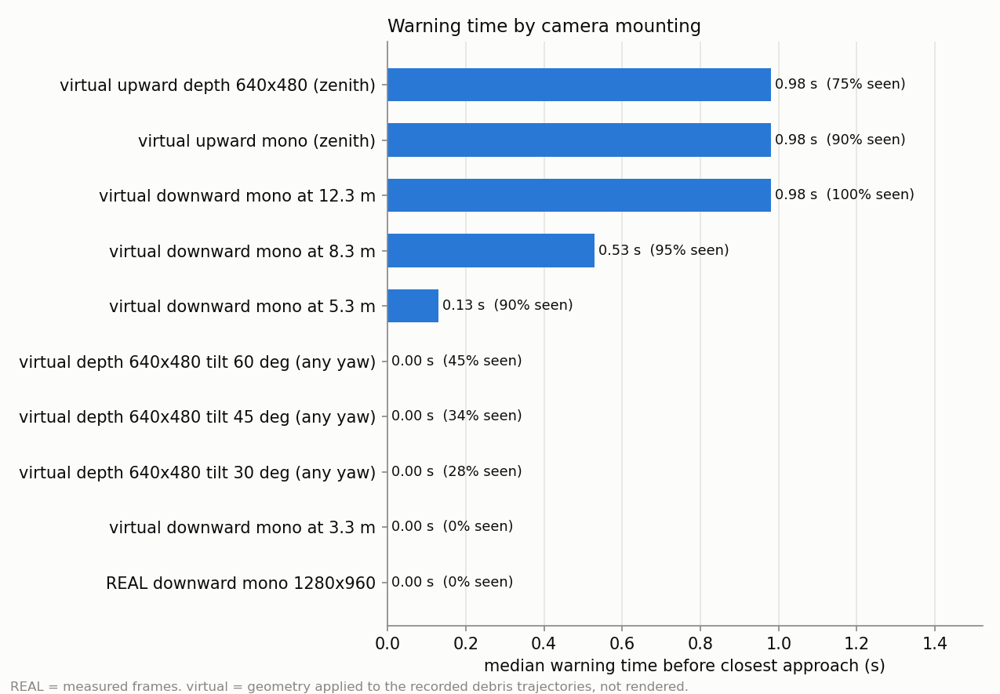
</p>

*Figure 7. Median warning time before closest approach for recorded falling-debris trajectories, by camera mounting.
"REAL" uses measured frames; "virtual" applies each camera's geometry to the recorded trajectories. The real downward
camera never saw debris in time (0.00 s); an upward camera gives about 0.98 s, which is why the upward depth camera was
added.*

<p align="center">
  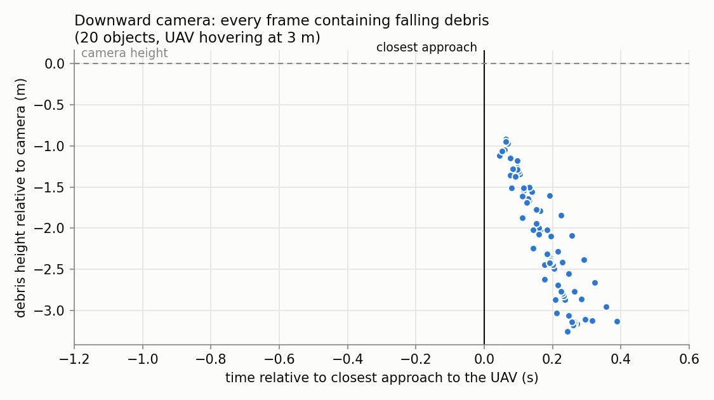
</p>

*Figure 8. Every downward-camera frame containing falling debris (20 objects, UAV hovering at 3 m). All sightings occur
after the closest approach, so the downward camera cannot warn of debris.*

### 8.2 Debris perception, tracking and prediction

| Stage | Result (Gazebo + PX4) |
|---|---|
| Detection | 86 of 86 objects that entered the field of view detected; frame-level recall 98.7 % (1713 / 1736); 0 of 1852 detections without a true object within 0.35 m |
| Tracking | position RMSE to the true surface 0.000–0.073 m over 7 live runs; 0 ID switches |
| Prediction | ballistic RMSE 0.110 m at 1.0 s and 0.414 m at 2.0 s (constant velocity: 4.44 m and 19.1 m) |
| Collision risk | free-fall recall 0.954 offline; warning lead median 0.80 s (minimum 0.43 s) |
| Processing time | detection 2.5–7.7 ms median per frame; tracking, prediction and risk each under 1 ms median |

<p align="center">
  
</p>

*Figure 9. Position RMSE to the true surface versus prediction horizon (log scale). Only the ballistic (gravity) model
stays below 0.5 m up to 2 s.*

<p align="center">
  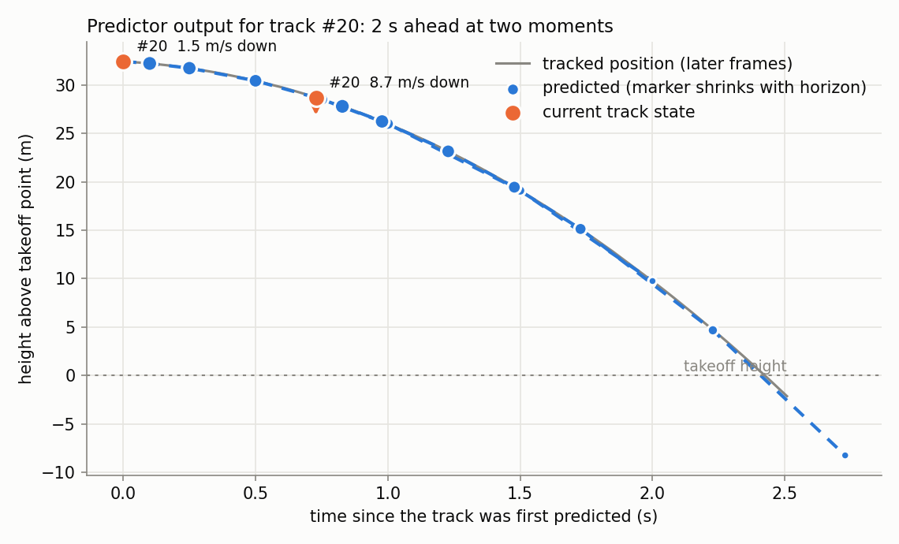
</p>

*Figure 10. Predictor output for one falling object (track #20), 2 s ahead, at two moments; the later tracked positions
(grey) follow the prediction (blue).*

<p align="center">
  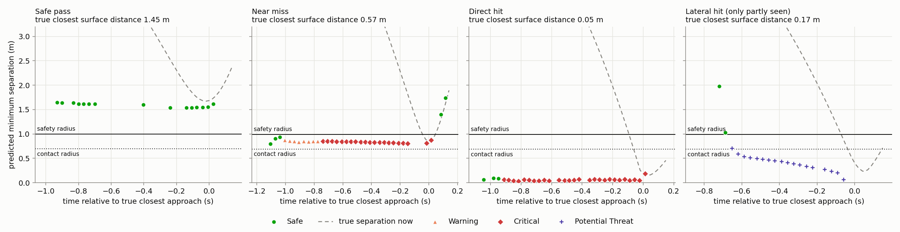
</p>

*Figure 11. Predicted minimum separation and risk state for four objects: a safe pass, a near miss, a direct hit, and a
lateral hit seen only partly. The dashed line is the true separation; the horizontal lines are the safety and contact
radii.*

### 8.3 Debris avoidance

Final Phase 6 batch of 14 scenarios, each flown without and with avoidance:

| Metric | Without avoidance | With avoidance |
|---|---|---|
| Runs with a collision | 11 of 14 | 5 of 14 |
| Missions completed | 3 of 14 | 10 of 14 |
| Collisions / boxes released | 15 / 42 | 6 / 52 |
| Direct hits on a hovering UAV avoided | – | 15 of 15 (smallest separation 0.91 m) |
| Unnecessary manoeuvres | – | 1 of 25 |

Over the 25 manoeuvres, the median warning lead was 1.30 s, the median start latency 0.068 s, and the median planner
compute time 8.8 ms per cycle. Every collision in the batch had a lead time of 0.70 s or less; every threat with at
least 0.94 s of warning was avoided.

| Scenario (figure) | Situation | Collisions | Closest surface distance |
|---|---|---|---|
| `C_direct` (12) | boxes dropped straight onto a hovering UAV | 0 of 3 | 1.66 m |
| `E_multiple` | several boxes at once | 0 of 5 | 0.91 m |
| `T_44` | steady cruise at 4.4 m/s | 0 of 3 | 2.68 m |
| `GAP_500_0` | depth camera blacked out for 0.5 s | 0 of 3 | 0.64 m |
| `H_transit` (13) | UAV already accelerating hard | **1 of 3** | 0.37 m |
| `F_lateral` | box thrown sideways | **1 of 3** | 0.16 m |

The last two are **known failures**, kept on purpose: under hard acceleration and for lateral throws the warning arrives
too late (the minimum lead time for success is about 0.9 s).

<p align="center">
  
</p>

*Figure 12. Scenario `C_direct`: three boxes dropped onto a hovering UAV, 0 collisions, minimum surface separation
1.659 m. Left: top view with the selected (blue), feasible (green) and rejected (red) candidates. Centre: side view with
tracked debris coloured by risk state. Right: true separation against the safety and contact radii.*

<p align="center">
  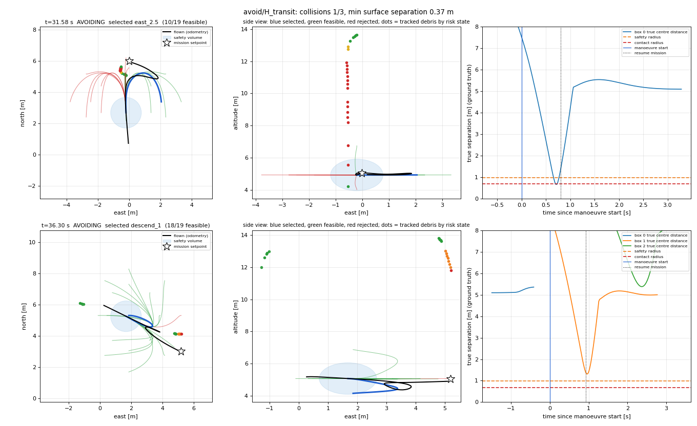
</p>

*Figure 13. Known failure, scenario `H_transit`: with the UAV already accelerating hard, one of three boxes collides
(minimum surface separation 0.37 m).*

Further figures for the other scenarios are in [`results/final/figures/`](results/final/figures/) (files `10`, `12`,
`13`, `14` and `19`).

### 8.4 Survivor perception and VLM

| Metric | Result |
|---|---|
| Candidate detector, live: precision / recall / F1 | 0.7228 / 1.0000 / 0.8391 |
| VLM alone, held-out crops: clear survivors confirmed | 24 of 45 (20 rejected, 1 uncertain) |
| VLM alone: non-survivors rejected | 98 of 100 (0 confirmed) |
| VLM alone: oblique view vs straight-down view confirmed | 24 of 32 vs 0 of 13 |
| Survivors reaching SURVIVOR_CONFIRMED in live flights | 4 of 8 |
| Frames labelled SURVIVOR_CONFIRMED on a non-survivor | 0 |
| Confirmations with the VLM switched off | 0 in 11 flights |
| VLM latency, GPU (65 requests) / CPU | median 2.36 s / 44–130 s |

The VLM almost never confirms a straight-down view, which is why the search planner flies to oblique inspection
viewpoints (§6.12).

<p align="center">
  
  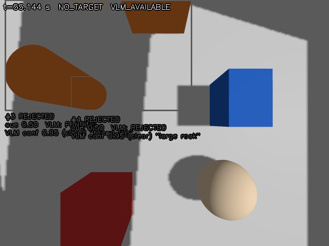
  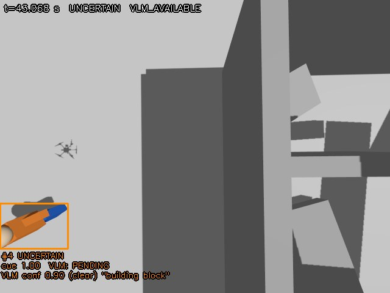
</p>

*Figure 14. Survivor perception debug views. Left: `SURVIVOR_CONFIRMED` (VLM confidence 0.95). Centre: orange and
skin-tone look-alikes rejected by the VLM. Right: the detector's cues are strong but the VLM disagrees, so the track is
reported `UNCERTAIN`.*

<p align="center">
  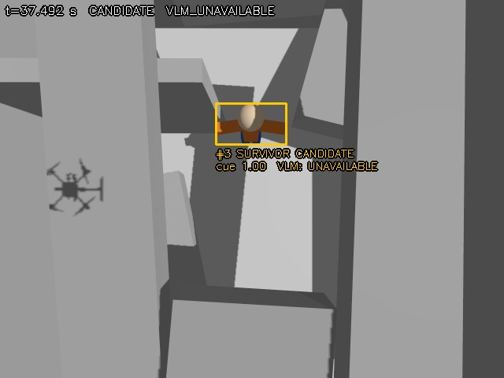
</p>

*Figure 15. With the VLM switched off, a clear survivor stays a `CANDIDATE` with `VLM_UNAVAILABLE`: the system never
claims a confirmation it has not verified.*

### 8.5 Complete system: Gazebo + PX4

Urban world, Intel graphics, real-time factor about 0.5.

| Test | Result |
|---|---|
| Evaluation batch (exterior areas) | 10 of 10 flights completed and landed; all PX4-log checks passed; 0 failsafes |
| Survivors in the searched areas | 8 of 9 found; localisation error median 0.21 m, maximum 1.07 m |
| Falling debris (6 boxes) | 5 avoidance manoeuvres, 0 collisions, closest box 1.34 m |
| VLM mission, final check (`urban_B`, CPU VLM) | took off, searched, inspected; VLM confirmed after 3 rejections; survivor located 0.13 m from truth; returned and landed |
| Look-alike control (`urban_F`) | tarp rejected by the VLM 3 times; nothing confirmed |
| Fault injection | SLAM killed at 60 s → return and land; navigator killed at 60 s → return and land |
| SLAM pose RMSE | 0.5–2.8 m in the urban world; 0.08–0.57 m in the village world (17 flights) |
| Mission interpreter (held-out set of 30) | rules 24 / 30 correct, language model 23 / 30; 0 unsafe acceptances |

### 8.6 Complete system: MuJoCo

| Test | Result | Evidence |
|---|---|---|
| Missions (6 scenarios, no VLM) | 6 of 6 completed and landed, 0 collisions; 6 of 6 survivors in the searched areas located 0.21–0.46 m from truth (in `zone_C_headline` one survivor was reported as two tracks 0.8 m apart) | `simulation/mujoco/results/batch/*/mission_report.json` |
| False candidates without a VLM | 7 look-alike candidates in the scenarios that contain look-alikes; all stay `UNVERIFIED_CANDIDATE`, as none can be confirmed without a VLM | same |
| VLM crop test (Gemma 3 4B) | 4 of 4 look-alike crops rejected (barrel, tarp, cone, crate with ball); a straight-down survivor crop was also rejected; 49–65 s per answer on the CPU | `simulation/mujoco/results/faculty/vlm_test/vlm_test_gemma3_4b.json` |
| VLM mission (`urban_B`) | confirmed ("blocky human figure", 0.95); located 0.21 m from truth; 0 collisions | run logs not in the repository |
| VLM look-alike control (`urban_F`) | tarp rejected by the VLM | run logs not in the repository |
| Falling debris (3 boxes aimed at the drone) | 3 manoeuvres from the upward depth camera only; closest box 1.88 m; 0 collisions; survivor found; landed | run logs not in the repository |

### 8.7 Control performance

| Test | Result | Evidence |
|---|---|---|
| Gazebo + PX4, 5 hover flights | altitude RMSE 0.070–0.096 m; drift 0.042–0.059 m; landing offset 0.015–0.059 m | `results/final/phase0_flight_foundation/` |
| MuJoCo, own cascade, hover | altitude RMSE 9.4 mm | `simulation/mujoco/results/final/hover/report.json` |
| MuJoCo, 6-waypoint square at up to 4.4 m/s | cross-track RMSE 0.53 m, maximum 1.37 m | `simulation/mujoco/results/final/waypoints/report.json` |
| MuJoCo, routed flight around the blocked street | 111.0 m flown for a 95.9 m straight line; 0 collisions; closest lidar range 1.69 m | `simulation/mujoco/results/final/nav/report.json` |
| PX4 in the MuJoCo loop (unchanged PX4 and `flight_controller.py`, MAVLink HIL) | hover RMSE 4.4 cm; 3 waypoints reached to 0.4 / 17.6 / 0.4 cm; landing offset 0.35 m; 18 of 19 trials complete (1 lockstep hang) | `simulation/mujoco/results/px4_hil/` |
| Safety monitor | a stock waypoint route that hit the roof was caught at 8.6 s; PX4 AUTO LAND at 8.7 s | `results/final/METRICS_SUMMARY.md` |

<p align="center">
  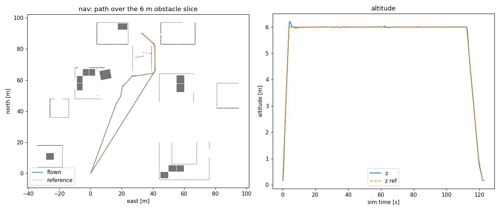
</p>

*Figure 16. MuJoCo routed flight in `urban_C`. Left: flown path over the 6 m obstacle slice; the navigator detours
around the blocked street (111.0 m flown vs 95.9 m straight line). Right: altitude against its reference.*

---

## 9. Repository Structure

The repository root is a ROS 2 workspace (`ros2_ws/` in the setup below).

```text
.
├── README.md                       this file
├── FRP.md                          proposed project work
├── LICENSE                         MIT
├── missions/                       mission files, place catalogues, instruction test set
├── src/
│   ├── px4_msgs/                   PX4 message definitions (clone separately, see §10.3)
│   ├── uav_interfaces/             project ROS 2 messages (AvoidanceCommand, SearchGoal, ...)
│   └── uav_autonomy/               main ROS 2 package
│       ├── uav_autonomy/           nodes and pure-logic modules
│       ├── config/                 Gazebo–ROS bridges, slam_toolbox, RViz
│       ├── launch/                 p2_perception.launch.py
│       ├── models/, models_slam/   x500_rescue variants, depth camera, 2-D lidar
│       ├── worlds/                 collapsed building, survivor variants, urban, village
│       └── test/                   557 unit tests
├── scripts/
│   ├── run_flight_trial.sh         one cold-start trial: Gazebo + PX4 + XRCE agent + nodes
│   ├── gcs_heartbeat.py            GCS heartbeat so PX4's link check passes
│   ├── disaster/                   urban world generator, validator, one-command demo
│   ├── mission/                    interpreter, mission runner, evaluation
│   ├── avoidance/, perception/, survivor/, search/, slam/, sensor_study/ ...
├── simulation/
│   ├── mujoco/                     second simulator: controllers, worlds, scripts, tests, results
│   └── object-track/               first PyBullet prototype (visual target tracking)
└── results/final/                  phase summaries and the 20 result figures
```

**Main ROS 2 executables** (`ros2 run uav_autonomy <name>`):

| Executable | Job |
|---|---|
| `flight_controller` | flies the mission; the only node that commands PX4 |
| `state_bridge` | republishes PX4 odometry as `/odom` |
| `debris_depth_detector`, `debris_tracker`, `debris_predictor`, `debris_risk`, `debris_avoidance` | debris chain, §6.6–6.10 |
| `debris_perception` | simpler debris detector on the RGB camera (earlier stage) |
| `survivor_perception`, `survivor_localization` | survivor chain, §6.14–6.15 |
| `search_planner`, `navigator`, `slam_bridge` | search, A* routing, lidar bridge for SLAM |
| `mission_manager`, `mission_viz` | mission supervision, RViz markers |
| `continuous_debris_spawner` | drops seeded test debris in Gazebo |

`rescue_mission.py` (and its `.backup`), `vlm_detector.py` and `vlm_perception.py` are from the project's first,
single-program attempt and are not used by the final system. `dynamic_obstacle_*.py` are empty placeholders from that
stage.

---

## 10. Installation

### 10.1 Prerequisites

| Requirement | Version or note |
|---|---|
| OS | Ubuntu 24.04 (the platform of ROS 2 Jazzy) |
| ROS 2 | Jazzy, desktop install [[12]](#ref-12) |
| Gazebo | Harmonic, with `ros_gz` [[13]](#ref-13), [[19]](#ref-19) |
| PX4-Autopilot | SITL build; must provide the message versions the controller subscribes to (`vehicle_status_v4`, `vehicle_local_position_v1`, `vehicle_command_ack_v1`) [[9]](#ref-9) |
| `px4_msgs` | from the same PX4 release as the autopilot [[14]](#ref-14) |
| Micro XRCE-DDS Agent | PX4–ROS 2 bridge [[10]](#ref-10), [[15]](#ref-15) |
| `slam_toolbox` | ROS 2 package [[2]](#ref-2), [[18]](#ref-18) |
| Python | NumPy, SciPy, OpenCV, Matplotlib, `pymavlink`, `pyulog` |
| Ollama + Gemma 3 4B | optional, for VLM verification [[3]](#ref-3), [[17]](#ref-17) |
| Hardware | a GPU is recommended; the CPU-only VLM takes 75–130 s per answer |

### 10.2 Workspace layout

The scripts expect PX4 next to the workspace (`PX4_DIR` defaults to `../PX4-Autopilot`) and, for the VLM demo, the
Ollama binary at `~/ollama/bin/ollama`:

```text
drones/
├── PX4-Autopilot/
└── ros2_ws/          ← this repository
```

### 10.3 Install the dependencies

```bash
# ROS 2 packages
sudo apt update
sudo apt install -y ros-jazzy-ros-gz ros-jazzy-slam-toolbox ros-jazzy-cv-bridge \
    ros-jazzy-vision-msgs python3-colcon-common-extensions python3-pip

# Python libraries
pip install --user numpy scipy opencv-python matplotlib pymavlink pyulog

# Workspace and PX4
mkdir -p ~/drones && cd ~/drones
git clone https://github.com/sandhiyaa031/Drones_S5_CD9_Vision_Language_UAV_Navigation.git ros2_ws
git clone --recursive https://github.com/PX4/PX4-Autopilot.git
bash PX4-Autopilot/Tools/setup/ubuntu.sh
cd PX4-Autopilot && make px4_sitl && cd ..

# px4_msgs: replace the empty folder with a checkout matching your PX4 release
cd ros2_ws/src && rm -rf px4_msgs
git clone https://github.com/PX4/px4_msgs.git
cd ..
```

Build the Micro XRCE-DDS Agent from source as described in the PX4 guide [[10]](#ref-10), so that `MicroXRCEAgent` is on
your `PATH`.

> [!NOTE]
> On Ubuntu 24.04, `pip install --user` may be blocked by PEP 668. In that case use `pip install --break-system-packages`
> or install the matching `python3-*` apt packages.

### 10.4 Build the workspace

```bash
cd ~/drones/ros2_ws
source /opt/ros/jazzy/setup.bash
colcon build --packages-select px4_msgs uav_interfaces uav_autonomy
source install/setup.bash
```

### 10.5 Optional: Vision-Language Model

```bash
# Install Ollama into ~/ollama (the location the demo scripts call), then:
OLLAMA_HOST=127.0.0.1:11434 ~/ollama/bin/ollama serve &
~/ollama/bin/ollama pull gemma3:4b

export VLM_ENDPOINT=http://127.0.0.1:11434/v1
export VLM_MODEL=gemma3:4b
```

With an NVIDIA GPU, `scripts/disaster/run_demo.sh` uses `gemma3:4b`. Without one, it expects a CPU copy of the same
model named `gemma3-4b-cpu`. One way to create it is an Ollama Modelfile that disables GPU offload:

```bash
printf 'FROM gemma3:4b\nPARAMETER num_gpu 0\n' > Modelfile.cpu
~/ollama/bin/ollama create gemma3-4b-cpu -f Modelfile.cpu
```

### 10.6 Optional: MuJoCo environment

```bash
cd ~/drones/ros2_ws/simulation/mujoco
./setup_env.sh                 # creates .venv and installs mujoco>=3.2,<4
source .venv/bin/activate
```

ROS 2, Gazebo and PX4 are not needed for MuJoCo.

---

## 11. Running the System

Run one simulator at a time. All Gazebo commands assume the workspace is sourced:

```bash
cd ~/drones/ros2_ws && source /opt/ros/jazzy/setup.bash && source install/setup.bash
```

### 11.1 Single flight trial (Gazebo + PX4)

```bash
# Take off, hover 30 s at 3 m, land; writes logs and ULog checks to the run directory
scripts/run_flight_trial.sh results/trial_01 hover
```

`run_flight_trial.sh` starts Gazebo, PX4 SITL, the Micro XRCE-DDS Agent (`udp4 -p 8888`), `gcs_heartbeat.py` and
`flight_controller`, then tears everything down and verifies the PX4 log. Options are set through environment variables
documented at the top of the script (for example `HEADLESS=0` for the Gazebo window, `PERCEPTION=1` for the debris
chain).

### 11.2 Full urban rescue mission (Gazebo + PX4 + ROS 2)

```bash
CONFIRM=yes VIZ=0 scripts/disaster/run_demo.sh \
  "Search the collapsed apartment block for survivors, only report confirmed ones, and return to base." \
  urban_B demo1
```

This generates the `urban_B` world, starts PX4, SLAM, the navigator, survivor perception, localisation, the search
planner and the mission manager, and opens a Gazebo window that follows the drone. It takes about 12 minutes with the
CPU VLM. Because the instruction says "only report confirmed ones", the mission is refused if no VLM is available. The
report is written to `results/disaster_gazebo/demo/`.

### 11.3 MuJoCo missions

```bash
cd ~/drones/ros2_ws/simulation/mujoco && source .venv/bin/activate

# Headless mission without a VLM (about 1.5 min of simulated search)
python3 scripts/run_mission.py \
  "Search the collapsed apartment block for survivors, report survivor locations, and return to base." \
  --scene urban_B --out ../../results/mujoco_B

# With the VLM and the viewer window
PYGLFW_LIBRARY_VARIANT=x11 MUJOCO_GL=glfw python3 scripts/run_mission.py \
  "Search the collapsed apartment block for survivors, report survivor locations, and return to base." \
  --scene urban_B --vlm gemma3:4b --gui --out ../../results/mujoco_B_vlm

# With three falling debris boxes
PYGLFW_LIBRARY_VARIANT=x11 MUJOCO_GL=glfw python3 scripts/run_mission.py \
  --scene urban_B --debris 3 --gui --out ../../results/mujoco_B_debris
```

`--vlm` takes any Ollama model name. Every run writes `mission_report.json`, `trajectory.csv` and detection images. For
headless rendering on a server, use `MUJOCO_GL=egl` instead of the `glfw` variables.

### 11.4 Evaluation scripts

```bash
# Score the mission interpreter on the held-out instruction set (no simulator needed)
PYTHONPATH=src/uav_autonomy python3 scripts/mission/evaluate_interpreter.py \
  --interpreter rules --split heldout --out interpreter_heldout.json
```

The Phase 6 and Phase 7 scenario scripts (`scripts/avoidance/run_scenario.sh <scenario> <baseline|avoid>`,
`scripts/survivor/run_scenario.sh <scenario>`) read debris release plans from `results/phase6/plans/`, which are not part
of the repository. Seeded plans can be generated with `scripts/sensor_study/make_plan.py --seed <n> --out <file>`.

---

## 12. Limitations and Future Work

| Limitation | Detail | Proposed work |
|---|---|---|
| **Not GPS-denied flight** | PX4 EKF2 fuses simulated GNSS. SLAM supplies the map, not the pose that flies the drone, and in the urban world it is less accurate than PX4's own odometry (0.5–2.8 m RMSE). | feed visual-inertial or lidar-inertial odometry into EKF2 in place of GNSS |
| 2-D SLAM | a single lidar slice at 6 m cannot see overhead slabs, so interiors are out of scope | 3-D mapping |
| CPU VLM | 75–130 s per answer on the development laptop; Gemma 3 4B is noisy (false rejections, odd labels such as "toy dart") | run the VLM on a GPU (about 2.4 s per answer was measured on GPU) |
| Real-time factor about 0.5 | on Intel graphics, telemetry gaps under heavy load can trip the watchdog; the demo raises `status_timeout_s` and `position_timeout_s` | GPU rendering |
| Debris | about 1 s of warning; fails under hard acceleration and for sideways throws; debris and the CPU VLM together in Gazebo were not reliable, so the debris demo is run separately | earlier detection, better UAV motion prediction |
| Survivor detector | a colour-and-shape baseline tuned to simulated manikins | learned person or pose detector, keeping VLM verification |
| MuJoCo | uses simulator state with no sensor noise and no SLAM; rubble is simplified; PX4 in the loop covers hover and waypoints only | noise models, full PX4 HIL missions |
| Controllability (§6.3) | holds for the linearised hover model only; does not cover large angles, saturation or aerodynamics beyond rotor drag | nonlinear analysis |
| Hardware | nothing has been flown | hardware-in-the-loop on a real x500 |

---

## 13. Testing

```bash
cd ~/drones/ros2_ws && source install/setup.bash

# ROS 2 package tests (unit tests + flake8/pep257 style checks)
colcon test --packages-select uav_autonomy
colcon test-result --verbose

# Unit tests only, with pytest (style checks excluded)
(cd src/uav_autonomy && python3 -m pytest test \
  --ignore=test/test_flake8.py --ignore=test/test_pep257.py --ignore=test/test_copyright.py)

# MuJoCo tests (headless)
(cd simulation/mujoco && source .venv/bin/activate && MUJOCO_GL=egl python3 -m pytest tests)
```

**557 unit tests**: 552 pass and 5 are skipped. Nine of them need the sourced ROS 2 workspace (eight in
`test_survivor_perception.py` start a real node, and one in `test_debris_tracking.py` imports `geometry_msgs`); without
it they error on the missing message packages, and the other 543 still pass. The style checks (flake8, pep257) are
reported separately. The MuJoCo suite has 12 further headless tests, all passing.

| Area | Test file | Tests |
|---|---|---|
| Survivor perception (detector, confirmation, VLM handling) | `test_survivor_perception.py` | 92 |
| Debris avoidance | `test_debris_avoidance.py` | 75 |
| Mission language | `test_mission_language.py` | 61 |
| Mission logic | `test_mission_logic.py` | 57 |
| Search planning | `test_search_planning.py` | 43 |
| Navigation (A*) | `test_navigation.py` | 43 |
| Debris tracking | `test_debris_tracking.py` | 42 |
| Survivor localisation | `test_survivor_localization.py` | 38 |
| Debris risk | `test_debris_risk.py` | 35 |
| Flight safety | `test_flight_safety.py` | 26 |
| Debris prediction | `test_debris_prediction.py` | 24 |
| Debris detection | `test_debris_detection.py` | 21 |
| **Total** | | **557** |

---

## 14. Metric Definitions

All metrics are computed offline against simulator ground truth.

| Metric | Definition |
|---|---|
| Precision, recall, F1 | $P = \frac{TP}{TP + FP}$, $R = \frac{TP}{TP + FN}$, $F_1 = \frac{2PR}{P + R}$, with true positives <i>T</i><i>P</i>, false positives <i>F</i><i>P</i> and false negatives <i>F</i><i>N</i> |
| RMSE | $\sqrt{\frac{1}{N}\sum_{k=1}^{N} e_k^2}$ over <i>N</i> samples of the error <i>e</i><sub><i>k</i></sub> |
| Debris position error | distance from the estimate to the true box surface (0 if on it) |
| Box collision | box surface within 0.40 m of the vehicle centre (near miss: within 0.70 m) |
| Warning lead time | first WARNING or CRITICAL frame to the true closest approach |
| ID switches | CLEAR MOT convention; a truth-to-track pairing is kept while within 0.6 m |
| Localisation error | horizontal distance between the reported and the true survivor position |
| Coverage | cells imaged / cells in the search area (0.5 m grid) |
| SLAM RMSE | RMS of the SLAM pose minus the true pose over the flight |
| Mission complete | landed safely and the report was written; `objective_met` additionally requires the area covered or a survivor confirmed |
| Controllability | PBH rank of the linearised model equals the number of states |
| Stability | all closed-loop eigenvalues have negative real parts |

---

## 15. References

### Research papers

- <a id="ref-1"></a>**[1]** X. Wang, D. Yang, Z. Wang, H. Kwan, J. Chen, W. Wu, H. Li, Y. Liao and S. Liu, "Towards
  Realistic UAV Vision-Language Navigation: Platform, Benchmark, and Methodology," *International Conference on Learning
  Representations (ICLR)*, 2025. [arXiv:2410.07087](https://arxiv.org/abs/2410.07087) ·
  [TravelUAV code](https://github.com/buaa-colalab/TravelUAV). **Base paper.**
- <a id="ref-2"></a>**[2]** S. Macenski and I. Jambrecic, "SLAM Toolbox: SLAM for the dynamic world," *Journal of Open
  Source Software*, vol. 6, no. 61, p. 2783, 2021. [doi:10.21105/joss.02783](https://doi.org/10.21105/joss.02783)
- <a id="ref-3"></a>**[3]** Gemma Team, Google DeepMind, "Gemma 3 Technical Report," 2025.
  [arXiv:2503.19786](https://arxiv.org/abs/2503.19786)
- <a id="ref-4"></a>**[4]** E. Todorov, T. Erez and Y. Tassa, "MuJoCo: A physics engine for model-based control,"
  *IEEE/RSJ International Conference on Intelligent Robots and Systems (IROS)*, 2012.
  [doi:10.1109/IROS.2012.6386109](https://doi.org/10.1109/IROS.2012.6386109)
- <a id="ref-5"></a>**[5]** R. E. Kalman, "A New Approach to Linear Filtering and Prediction Problems," *Journal of
  Basic Engineering*, vol. 82, no. 1, pp. 35–45, 1960. [doi:10.1115/1.3662552](https://doi.org/10.1115/1.3662552)
- <a id="ref-6"></a>**[6]** P. E. Hart, N. J. Nilsson and B. Raphael, "A Formal Basis for the Heuristic Determination
  of Minimum Cost Paths," *IEEE Transactions on Systems Science and Cybernetics*, vol. 4, no. 2, pp. 100–107, 1968.
  [doi:10.1109/TSSC.1968.300136](https://doi.org/10.1109/TSSC.1968.300136)
- <a id="ref-7"></a>**[7]** H. W. Kuhn, "The Hungarian Method for the Assignment Problem," *Naval Research Logistics
  Quarterly*, vol. 2, pp. 83–97, 1955. [doi:10.1002/nav.3800020109](https://doi.org/10.1002/nav.3800020109)
- <a id="ref-8"></a>**[8]** M. L. J. Hautus, "Controllability and Observability Conditions of Linear Autonomous
  Systems," *Indagationes Mathematicae (Proceedings)*, vol. 72, pp. 443–448, 1969.

### Official documentation and software

- <a id="ref-9"></a>**[9]** PX4 Autopilot User Guide, "ROS 2." <https://docs.px4.io/main/en/ros2/>
- <a id="ref-10"></a>**[10]** PX4 Autopilot User Guide, "uXRCE-DDS (PX4–ROS 2/DDS Bridge)."
  <https://docs.px4.io/main/en/middleware/uxrce_dds>
- <a id="ref-11"></a>**[11]** PX4 Autopilot User Guide, "Offboard Mode." <https://docs.px4.io/main/en/flight_modes/offboard>
- <a id="ref-12"></a>**[12]** ROS 2 Jazzy documentation. <https://docs.ros.org/en/jazzy/>
- <a id="ref-13"></a>**[13]** Gazebo Harmonic documentation. <https://gazebosim.org/docs/harmonic/>
- <a id="ref-14"></a>**[14]** PX4, `px4_msgs` (ROS 2 message definitions). <https://github.com/PX4/px4_msgs>
- <a id="ref-15"></a>**[15]** eProsima, Micro XRCE-DDS Agent. <https://github.com/eProsima/Micro-XRCE-DDS-Agent>
- <a id="ref-16"></a>**[16]** MuJoCo documentation. <https://mujoco.readthedocs.io/>
- <a id="ref-17"></a>**[17]** Ollama, Gemma 3 model library. <https://ollama.com/library/gemma3>
- <a id="ref-18"></a>**[18]** `slam_toolbox` source code. <https://github.com/SteveMacenski/slam_toolbox>
- <a id="ref-19"></a>**[19]** `ros_gz` (Gazebo–ROS 2 integration). <https://github.com/gazebosim/ros_gz>
- <a id="ref-20"></a>**[20]** OpenCV documentation. <https://docs.opencv.org/>
- <a id="ref-21"></a>**[21]** SciPy, `scipy.optimize.linear_sum_assignment`.
  <https://docs.scipy.org/doc/scipy/reference/generated/scipy.optimize.linear_sum_assignment.html>
- <a id="ref-22"></a>**[22]** NumPy documentation. <https://numpy.org/doc/>
- <a id="ref-23"></a>**[23]** `pymavlink` (MAVLink Python library). <https://github.com/ArduPilot/pymavlink>
- <a id="ref-24"></a>**[24]** `pyulog` (PX4 ULog parser). <https://github.com/PX4/pyulog>

---

<div align="center">

**Amrita Vishwa Vidyapeetham**

</div>
