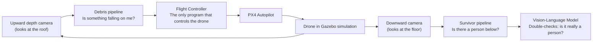
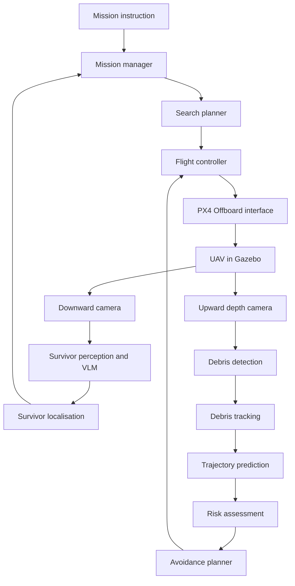

<p align="center">
  
</p>

# Vision-Language UAV Navigation for GPS-Denied Environments

### Vision-Language Navigation | UAV | Computer Vision | GPS-Denied Navigation | ROS 2 | PX4 | Gazebo

---

## Team Members

| S. No. | Name | Roll Number | Email |
|---|---|---|---|
| 1 | JENISHAA BHARATHI M | CB.SC.U4AIE24221 | cb.sc.u4aie24221@cb.students.amrita.edu |
| 2 | NAVEEN K | CB.SC.U4AIE24235 | cb.sc.u4aie24235@cb.students.amrita.edu |
| 3 | POOJA N | CB.SC.U4AIE24242 | cb.sc.u4aie24242@cb.students.amrita.edu |
| 4 | PRANESH M | CB.SC.U4AIE24345 | cb.sc.u4aie24345@cb.students.amrita.edu |
| 5 | SANDHIYA D | CB.SC.U4AIE24353 | cb.sc.u4aie24353@cb.students.amrita.edu |

---

## Table of Contents

1. [The Project in One Minute](#1-the-project-in-one-minute)
2. [Why This Problem Matters](#2-why-this-problem-matters)
3. [Key Terms Used in This README](#3-key-terms-used-in-this-readme)
4. [How the System Works (Big Picture)](#4-how-the-system-works-big-picture)
5. [Part 1 – Flying the Drone](#5-part-1--flying-the-drone)
6. [Part 2 – Avoiding Falling Debris](#6-part-2--avoiding-falling-debris)
7. [Part 3 – Finding Survivors](#7-part-3--finding-survivors)
8. [The Simulated World](#8-the-simulated-world)
9. [What Is Inside This Repository](#9-what-is-inside-this-repository)
10. [Results](#10-results)
11. [Testing](#11-testing)
12. [How to Build and Run](#12-how-to-build-and-run)
13. [Current Limitations and Next Steps](#13-current-limitations-and-next-steps)
14. [Base Paper](#14-base-paper)
15. [License](#15-license)

---

## 1. The Project in One Minute

Imagine a building has collapsed after an earthquake. Rescue teams want to know if anyone is trapped inside, but it is too dangerous to send people in first.

**Our idea:** send a drone in instead.

But a drone inside a collapsed building faces three big problems:

| Problem | Why it is hard | What our system does |
|---|---|---|
| **No GPS** | GPS signals do not reach inside buildings | The drone uses only its own onboard sensors to know where it is |
| **Falling debris** | Pieces of the broken roof can fall at any moment | An upward-facing camera spots falling objects and the drone moves out of the way |
| **Finding people** | The drone must decide whether something it sees is a person | A downward camera finds possible survivors, and an AI model that understands images and language (a **Vision-Language Model**) double-checks them |

Everything runs in a **computer simulation**, so we can test safely without crashing a real drone.

---

## 2. Why This Problem Matters

Most drones today fly by following GPS points or by being controlled by a pilot. Neither works well in disaster zones:

- GPS does not work indoors or under rubble.
- A pilot outside cannot see what the drone sees quickly enough to dodge something falling.
- Drones that only follow fixed instructions cannot "understand" what they are looking at.

Our project is a step towards drones that can **see, understand and react on their own** in such places.

---

## 3. Key Terms


| Term | Meaning |
|---|---|
| **UAV** | Unmanned Aerial Vehicle, i.e. a drone |
| **GPS-denied** | A place where GPS does not work, like inside a building |
| **PX4** | Free, open-source software that keeps a drone stable in the air. It is the drone's "autopilot" |
| **Offboard mode** | A PX4 mode where an outside program tells the drone where to go |
| **ROS 2** | Robot Operating System. It lets different programs (called **nodes**) send messages to each other |
| **Node** | One small program in ROS 2 that does one job, for example "detect debris" |
| **Topic** | A named channel nodes use to send messages, for example `/camera/image_raw` |
| **Gazebo** | A 3D simulator with realistic physics and cameras |
| **SITL** | Software-In-The-Loop: running the real PX4 autopilot on a computer instead of a real drone |
| **Depth camera** | A camera that measures how far away each point is, not just its colour |
| **VLM** | Vision-Language Model: an AI that can look at an image and answer questions about it in words |
| **Kalman filter** | A maths method that combines noisy measurements over time to get a better estimate of where something is and how fast it moves |
| **Ground truth** | The exact true positions known by the simulator. We use it only to **check** our results, never to help the drone |

---

## 4. How the System Works (Big Picture)

The drone has **two cameras** and runs **three main jobs** at the same time.



Two important rules we followed:

1. **Only one program controls the drone.** The flight controller is the only program allowed to send commands to PX4. Other programs can only *suggest* a move, and the flight controller checks the suggestion is safe before using it.
2. **The drone never cheats.** The drone only uses what its own cameras and sensors can see. The simulator's true positions are saved separately and used only afterwards to grade how well the drone did.

---

## 5. Part 1 – Flying the Drone

**File:** `src/uav_autonomy/uav_autonomy/flight_controller.py`

The flight controller makes the drone fly a full mission by itself. It goes through these steps one after another:

```text
Wait for sensor data
      ↓
Switch PX4 to Offboard mode
      ↓
Arm the motors
      ↓
Take off to 3 metres
      ↓
(Optional) Fly to waypoint 1 → waypoint 2 → back home
      ↓
Hover
      ↓
Land
      ↓
Done
```

If anything goes wrong at any step (for example a timeout), it switches to a **failsafe** state.

Supporting files:

| File | What it does |
|---|---|
| `flight_safety.py` | Watches the drone's position and raises a flag if it goes outside safe limits (for example too high or too low) |
| `avoidance_interface.py` | The safety rules used to accept or reject a dodge suggestion |
| `state_bridge.py` | Converts the drone's position from PX4's coordinate system to the one ROS 2 tools use, so it can be shown in visual tools like RViz |

---

## 6. Part 2 – Avoiding Falling Debris

### Why an upward camera?

At first we only had the normal downward camera. We tested it with 20 falling objects and found it **never saw a single one in time**. So we added an **upward-facing depth camera** that looks at the roof. This gave the drone about **1 second of warning** on average, which is enough to move.

### The five steps

The debris system works like a chain. Each step passes its result to the next.

```text
1. DETECT     →  2. TRACK      →  3. PREDICT     →  4. ASSESS RISK   →  5. DODGE
"I see an        "That's the       "It will land     "It will hit me     "Move 1 m
 object above"    same object       here in 1.2 s"    in 0.8 s!"          to the left"
                  as before"
```

| Step | What happens, in simple words | Files |
|---|---|---|
| **1. Detect** | Looks at the depth image, finds blobs that are closer than the roof, and works out their 3D position | `debris_detection.py`, `debris_depth_detector.py` |
| **2. Track** | Matches each new detection to objects seen earlier, so every falling object gets an ID and a speed (uses a Kalman filter) | `debris_tracking.py`, `debris_tracker.py` |
| **3. Predict** | Guesses where each object will be in the next 2 seconds. We tried three ways: constant speed, estimated acceleration, and **gravity**. Gravity was by far the best | `debris_prediction.py`, `debris_predictor.py` |
| **4. Assess risk** | Checks how close each object will come to the drone and labels it **SAFE**, **WATCH**, **WARNING** or **CRITICAL** | `debris_risk.py`, `debris_risk_node.py` |
| **5. Dodge** | Tries many possible moves (stay, move left, right, forward, down…), simulates how the drone would actually fly each one, throws away any that are unsafe, and picks the best of the rest | `debris_avoidance.py`, `debris_avoidance_node.py` |

The dodge step only **suggests** a move. The flight controller checks it and decides.

**Debris for testing** is dropped in the simulator by `continuous_debris_spawner.py`. It drops real physical boxes that fall under gravity, and uses a fixed random seed so every test can be repeated exactly.

---

## 7. Part 3 – Finding Survivors

In our simulated building there is a **manikin** (a dummy person) wearing orange clothes, with a skin-coloured head and blue legs.

### The three steps

```text
1. FIND CANDIDATES    →    2. CONFIRM OVER TIME    →    3. ASK THE VLM
"There's something         "I've seen it in many         "Is this really
 orange and person-          frames, it's not a            a person?"
 shaped down there"          one-off glitch"
```

| Step | What happens, in simple words | File |
|---|---|---|
| **1. Find candidates** | Looks for orange regions in the image, then checks whether a head, legs and a body-like shape are attached. Gives a score from 0 to 1 | `survivor_detection.py` |
| **2. Confirm over time** | Ignores anything seen in only one frame. A candidate must appear again and again before it is reported | `survivor_confirmation.py` |
| **3. Ask the VLM** | Cuts out a small image of the candidate and sends it to a Vision-Language Model to check if it is a person | `vlm_client.py` |

All three are joined together in `survivor_perception_node.py`.

### How we ask the VLM

We ask in **two separate questions**:

1. *"Describe the main object in this picture."* (We do not mention people, so we don't lead the AI.)
2. *"Does this description sound like a person?"*

We first tried asking directly *"Is this a person?"*, but the small AI models we used either said **yes to everything** or **no to everything**, depending on the wording. Splitting it into two questions fixed this.

### What the drone reports

| Label | Meaning |
|---|---|
| `CANDIDATE` | Looks like a person, waiting for the VLM to answer |
| `SURVIVOR_CONFIRMED` | The VLM agrees it is a person |
| `UNCERTAIN` | Not sure, or the detector and the VLM disagree |
| `REJECTED` | Not a person |

If the VLM is switched off or fails, the drone **never** says "confirmed". It stays at `CANDIDATE` or `UNCERTAIN`.

### Finding the survivor's position in 3D

**Files:** `survivor_localization.py`, `survivor_localization_node.py`

A single camera image only tells you the **direction** of the person, not how far away they are. So the drone combines views from different positions as it flies. Where the lines of sight cross, that is where the person is (this is called **triangulation**). The result is the survivor's position in the drone's own map.

---

## 8. The Simulated World

| File | What it is |
|---|---|
| `worlds/collapsed_building_rescue.sdf` | The main world: a building with broken walls, a hole in the roof, fallen concrete, rubble and the survivor manikin |
| `worlds/depth_validation.sdf` | An empty world used only to test that the depth camera measures distances correctly |
| `worlds/survivor_variants/` | Six versions of the main world for testing the survivor search (see below) |
| `models/x500_rescue/` | Our drone: the PX4 X500 quadcopter with a downward camera and an upward depth camera |
| `models/depth_cam_up/` | The upward depth camera (640×480 pixels, 30 frames per second, sees from 0.2 m to 35 m) |

The six test worlds:

| World | What is different | What it tests |
|---|---|---|
| `occluded` | A panel partly hides the survivor | Can it still find a partly hidden person? |
| `rubble` | Rubble around the survivor | Can it handle a cluttered scene? |
| `outdoor` | Survivor in an open area | Different lighting and background |
| `none` | No survivor at all | Does it wrongly "find" someone who isn't there? |
| `multi` | Several survivors | Can it find more than one? |
| `distractors` | Orange and skin-coloured objects that are not people | Can it avoid being fooled? |

---

## 9. What Is Inside This Repository

```text
├── amrita.png                  University logo
├── LICENSE                     MIT License
├── README.md                   This file
│
├── src/uav_autonomy/           The main ROS 2 package
│   ├── uav_autonomy/           All the Python code (flight, debris, survivors)
│   ├── worlds/                 Simulated environments
│   ├── models/                 The drone and its cameras
│   ├── config/                 Settings for connecting Gazebo cameras to ROS 2
│   ├── launch/                 A launch file to start the perception nodes together
│   └── test/                   Automatic tests
│
├── scripts/                    Tools to run flights and grade results
│   ├── run_flight_trial.sh     Starts the whole simulation and flies one mission
│   ├── demo_live.sh            A visual demo with falling debris
│   ├── sensor_study/           Experiments to decide which camera to use
│   ├── sensor_integration/     Checks that the camera and clocks are correct
│   ├── perception/             Grades debris detection, tracking, prediction and risk
│   ├── avoidance/              Runs and grades debris-dodging flights
│   └── survivor/               Runs and grades survivor-search flights
│
├── simulation/object-track/    Our first prototype (see below)
│
└── results/final/figures/      The 20 result images shown in Section 10
```

### Main programs in the package

| Program | Job |
|---|---|
| `flight_controller` | Flies the mission; the only program that commands the drone |
| `state_bridge` | Shares the drone's position with other ROS 2 tools |
| `debris_depth_detector` | Step 1 of debris: detect |
| `debris_tracker` | Step 2 of debris: track |
| `debris_predictor` | Step 3 of debris: predict |
| `debris_risk` | Step 4 of debris: assess risk |
| `debris_avoidance` | Step 5 of debris: suggest a dodge |
| `debris_perception` | A simpler debris detector that uses the normal camera |
| `survivor_perception` | Finds survivors and asks the VLM |
| `survivor_localization` | Works out where survivors are in 3D |
| `continuous_debris_spawner` | Drops test debris in the simulator |

### Older files kept for reference

`rescue_mission.py` (and its `.backup`), `vlm_detector.py` and `vlm_perception.py` are from our **first attempt**, where everything was in one program and detection used simple colour matching. The files `dynamic_obstacle_simulator.py`, `dynamic_obstacle_tracker.py` and `dynamic_obstacle_vision.py` are empty placeholders from that stage. They are not used by the final system.

### Our first prototype

`simulation/object-track/` is where the project began. Using a lighter simulator called **PyBullet**, a drone follows a moving green ball using only its camera:

- `moving_target.py` moves the ball in a circle, figure-8 or random path.
- `camera_tracker.py` finds the green ball in the image and uses **PID controllers** to turn "the ball is to the left of centre" into "move left".
- `track_demo.py` runs it. You can move the ball yourself with the W/A/S/D/R/F keys.

```bash
cd simulation/object-track
pip install -r requirements.txt
python3 track_demo.py
```

---

## 10. Results

All result images are in `results/final/figures/`.

### Choosing the right camera

| Camera | Average warning before debris reaches the drone |
|---|---|
| Normal downward camera | **0.00 s** (it saw none of the 20 falling objects in time) |
| Upward depth camera | **about 0.98 s** |

This is why we added the upward camera. (See figures `03` and `04`.)

### How well we predict where debris will fall

Error 2 seconds into the future (lower is better):

| Method | Error |
|---|---|
| Assume constant speed | 19.06 m |
| Estimate acceleration | 10.81 m |
| **Use gravity** | **0.41 m** |

(See figure `07`.)

### Dodging falling debris

| Test | What happens | Hits | Closest distance |
|---|---|---|---|
| Direct hits | Boxes dropped straight onto the drone | 0 out of 3 | 1.66 m |
| Multiple objects | Several boxes falling at once | 0 out of 5 | 0.91 m |
| Fast flight | Drone flying at 4.4 m/s | 0 out of 3 | 2.68 m |
| Camera gap | Camera blacks out for 0.5 s | 0 out of 3 | 0.64 m |
| Hard acceleration | Drone already speeding up hard | **1 out of 3** | 0.37 m |
| Sideways throw | Box thrown sideways, not dropped | **1 out of 3** | 0.16 m |

The last two are **failures**, and we have included them on purpose. They show the situations our system cannot yet handle. (See figures `09` to `14`.)

### Finding survivors

| Figure | What it shows |
|---|---|
| `15_survivor_confirmed_by_vlm.jpg` | A survivor found and confirmed by the VLM |
| `16_survivor_distractor_scene.jpg` | Orange objects correctly rejected as "not a person" |
| `17_survivor_outdoor_pass.jpg` | A case where the detector and VLM disagree, so the drone reports "uncertain" |
| `18_vlm_dataset_samples.jpg` | Example image crops used to test the VLM |

### Final demo check (06-10-2026)

| Figure | What it shows |
|---|---|
| `19_demo_check_2026-10-06_avoidance.png` | Direct-hit test repeated: 0 hits out of 3, closest distance 1.83 m |
| `20_demo_check_2026-10-06_survivor_candidate.jpg` | With the VLM turned off, the drone correctly stops at "candidate" and does not claim a confirmed survivor |

### Demo video


https://github.com/user-attachments/assets/2fb6d563-4f80-4912-8aa7-344652a465b7


---

## 11. Testing

The folder `src/uav_autonomy/test/` contains **318 automatic tests** that check each part of the code works as expected, plus code-style checks.

| What is tested | Number of tests |
|---|---|
| Survivor perception | 79 |
| Debris avoidance | 68 |
| Debris tracking | 36 |
| Debris risk | 35 |
| Survivor localisation | 35 |
| Debris prediction | 22 |
| Debris detection | 21 |
| Flight safety | 21 |

To run them:

```bash
colcon test --packages-select uav_autonomy
colcon test-result --verbose
```

---

## 12. How to Build and Run

### What you need

- Ubuntu with **ROS 2 Jazzy**
- **PX4-Autopilot** with Gazebo (the scripts look for it in a folder next to this project called `PX4-Autopilot`)
- The `px4_msgs` and `uav_interfaces` message packages in the same ROS 2 workspace
- `ros_gz_bridge` and the Micro XRCE-DDS Agent
- Python libraries: `numpy`, `scipy`, `opencv`
- *(Optional)* A Vision-Language Model server, for example Ollama, for survivor checking

### Build

```bash
source /opt/ros/jazzy/setup.bash
cd <your_workspace>
colcon build --packages-select uav_autonomy
source install/setup.bash
```

### Run

```bash
# Fly one simple mission (take off, hover, land)
scripts/run_flight_trial.sh results/trial_01 hover

# Watch a live demo with falling debris
scripts/demo_live.sh

# Debris test: first without dodging, then with dodging
scripts/avoidance/run_scenario.sh C_direct baseline
scripts/avoidance/run_scenario.sh C_direct avoid

# Survivor search using a VLM
export VLM_ENDPOINT=http://localhost:11434/v1
export VLM_MODEL=<model-name>
scripts/survivor/run_scenario.sh A_clear
```


---

## 13. Base Paper

This project is inspired by the UAV Vision-Language Navigation problem studied in:

> **Towards Realistic UAV Vision-Language Navigation: Platform, Benchmark, and Methodology**

**Paper:**  
https://arxiv.org/pdf/2410.07087

**TravelUAV Repository:**  
https://github.com/buaa-colalab/TravelUAV

The paper provides the research foundation for the Vision-Language Navigation aspect of this project, while this repository develops an independent simulation and ROS 2–PX4 based implementation.

---

## 14. License

This project is released under the MIT License. See [`LICENSE`](LICENSE).

---

<div align="center">

### Amrita Vishwa Vidyapeetham

**Vision-Language UAV Navigation for GPS-Denied Environments**

</div>


---

## Additional Technical Documentation

The following sections supplement the existing project description with further details about the control architecture, mathematical formulation, ROS 2 interfaces, evaluation methodology, reproducibility and limitations. They are intended to document the system without replacing the existing sections above.

## A. Main Control Logic and Mathematical Formulation

### A.1 Hierarchical control architecture

The system separates mission-level decisions from flight execution. The mission manager supervises the rescue task, perception modules process camera data, planning modules generate search or avoidance proposals, and the flight controller selects the target that is sent to PX4.

The intended data flow is:



This diagram represents the intended system-level data flow. The exact runtime connections should be checked against the launch files and ROS 2 topic graph.

The control architecture follows three principles:

1. **Single command authority:** the flight controller is the application component responsible for publishing flight setpoints to PX4.
2. **Proposal-based planning:** perception and planning components provide detections, estimates or proposed targets rather than independently commanding the aircraft.
3. **Feedback-based execution:** the controller uses vehicle telemetry and mission status to monitor progress and determine subsequent actions.

### A.2 Position error

Let the estimated UAV position be

\[
\mathbf{p} =
\begin{bmatrix}
x & y & z
\end{bmatrix}^{T}
\]

and the selected target position be

\[
\mathbf{p}^{*} =
\begin{bmatrix}
x^{*} & y^{*} & z^{*}
\end{bmatrix}^{T}.
\]

The position error is

\[
\mathbf{e}_{p} = \mathbf{p}^{*} - \mathbf{p}.
\]

The vector describes the displacement from the estimated current position to the target. Its horizontal component is

\[
\mathbf{e}_{xy} =
\begin{bmatrix}
x^{*}-x\\
y^{*}-y
\end{bmatrix},
\]

and its magnitude is

\[
d_{xy} = \|\mathbf{e}_{xy}\|_2
= \sqrt{(x^{*}-x)^2+(y^{*}-y)^2}.
\]

These expressions define position error mathematically. The coordinate frame and sign convention must be stated consistently with the implementation. PX4 commonly uses NED conventions for local position setpoints, whereas ROS visualisation tools commonly use ENU; any conversion must be verified in the state bridge and controller.

### A.3 PX4 setpoint tracking

The ROS 2 application publishes position setpoints through the PX4 interface. PX4's internal control loops then work to track the commanded position and generate the corresponding lower-level flight commands.

A simplified horizontal proportional relationship is

\[
\mathbf{v}_{xy,\mathrm{cmd}}
\approx K_{p,xy}\mathbf{e}_{xy}.
\]

Here, \(K_{p,xy}\) represents the relevant horizontal position-control gain. This equation is a simplified description of position-control behaviour, not a claim that the application implements the PX4 internal control loop. Actual behaviour depends on PX4's configured gains, limits, estimator state and controller implementation.

### A.4 Mission and avoidance target selection

Let \(\mathbf{p}_{m}\) be the mission target and \(\mathbf{p}_{a}\) be a valid avoidance target. The target-selection rule can be represented as

\[
\mathbf{p}_{\mathrm{cmd}} =
\begin{cases}
\mathbf{p}_{a}, & \text{if avoidance is active and valid},\\
\mathbf{p}_{m}, & \text{otherwise}.
\end{cases}
\]

The avoidance planner proposes a manoeuvre when predicted debris motion creates a risk. The flight controller checks the proposal according to its configured validation and freshness rules before using it. If an avoidance proposal becomes invalid or stale, the implemented timeout logic determines what happens next. Resuming the mission target should not be interpreted as a guarantee that the environment is safe.

### A.5 Setpoint displacement limiting

A controller may constrain the effective displacement toward a target so that a distant target does not result in an excessively large step. A general bounded-displacement expression is

\[
\mathbf{e}_{xy,\mathrm{lim}} =
\begin{cases}
\mathbf{e}_{xy}, & \|\mathbf{e}_{xy}\|_2 \leq d_{\max},\\[4pt]
\dfrac{d_{\max}}{\|\mathbf{e}_{xy}\|_2}\mathbf{e}_{xy},
& \|\mathbf{e}_{xy}\|_2 > d_{\max}.
\end{cases}
\]

Here, \(d_{\max}\) is a configured displacement bound. This is a general mathematical formulation; retain it as a description of the implementation only if it matches the actual `limit_setpoint(...)` logic and its parameters in `flight_controller.py`.

### A.6 Flight state machine

The flight controller uses explicit states to organise the flight lifecycle. The state names documented in the implementation include:

| State | Purpose |
|---|---|
| `STATE_WAIT_FOR_DATA` | Wait for required telemetry or input data. |
| `STATE_PRESTREAM` | Publish setpoints before requesting Offboard mode. |
| `STATE_REQUEST_OFFBOARD` | Request PX4 Offboard mode. |
| `STATE_REQUEST_ARM` | Request vehicle arming. |
| `STATE_TAKEOFF` | Track the takeoff target. |
| `STATE_SEARCH` | Execute the search mission. |
| `STATE_RETURN_HOME` | Return toward the configured home target. |
| `STATE_REQUEST_LAND` | Request landing. |
| `STATE_LANDING` | Monitor the landing sequence. |
| `STATE_COMPLETE` | Mark the mission as complete. |
| `STATE_FAILSAFE` | Handle a detected failure using the configured failure logic. |

Transitions depend on the controller's state, telemetry, acknowledgements, mission progress, timeouts and safety checks. The exact transition conditions should be taken from the current source code when preparing a formal state-transition diagram.

A failsafe request is not proof that a safe landing will always occur. The outcome depends on which components remain operational, PX4's current state, the available telemetry and the configured autopilot failsafes.

### A.7 Supervisory safety logic

The supervisory layer can monitor conditions such as:

- Missing or stale vehicle telemetry.
- PX4 arming and Offboard status.
- Takeoff, waypoint and landing timeouts.
- Invalid or unavailable planning targets.
- Stale avoidance proposals.
- Altitude and other configured safety limits.
- Command acknowledgements and subsystem failures.

When a configured condition is violated, the controller follows its failure-handling logic rather than continuing normal mission execution without checking the fault. The precise response is fault-specific and should be verified against the source code and fault-injection results.

### A.8 Controllability: scope and distinction

For a linear time-invariant model,

\[
\dot{\mathbf{x}} = A\mathbf{x}+B\mathbf{u},
\]

the controllability matrix is

\[
\mathcal{C} =
\begin{bmatrix}
B & AB & A^2B & \cdots & A^{n-1}B
\end{bmatrix}.
\]

The model is controllable if

\[
\operatorname{rank}(\mathcal{C})=n,
\]

where \(n\) is the number of state variables.

This is a standard mathematical criterion, not a result established merely by implementing the flight state machine or running a simulation. A claim of formal controllability for this UAV would require a defined dynamic model, explicit \(A\) and \(B\) matrices, and a rank analysis. The project should not claim that proof unless that analysis has actually been completed.

## B. ROS 2 Components and Interface Documentation

The following table summarises component responsibilities described in this README. It is not a substitute for the exact topic names and message types in the code.

| Component | Inputs | Outputs or responsibility |
|---|---|---|
| Flight controller | PX4 telemetry, mission targets, avoidance proposals | Publishes flight setpoints and issues configured vehicle commands |
| State bridge | PX4 vehicle-state data | Converts or exposes vehicle state for ROS 2 consumers |
| Debris detector | Upward-facing depth images | Produces debris detections |
| Debris tracker | Detections over time | Associates detections and estimates object motion |
| Debris predictor | Tracked-object state | Estimates future debris trajectories |
| Debris risk assessment | Predicted trajectories and UAV state | Classifies the estimated risk |
| Debris avoidance planner | Risk estimates and UAV state | Proposes an avoidance target |
| Survivor perception | Downward camera images | Produces candidates and VLM assessment |
| Survivor localisation | Observations and camera/vehicle geometry | Estimates survivor position |
| Mission manager | Mission objective and subsystem status | Supervises mission progression |
| Search planner | Search objective and available navigation information | Generates search targets |

### B.1 Exact interfaces to record

For a reproducible ROS 2 integration, document the following from the actual runtime and source code:

| Interface detail | What to record |
|---|---|
| Topic name | Exact ROS 2 topic, including namespace |
| Message type | Exact ROS 2 or PX4 message type |
| Publisher and subscriber | Node names at each end |
| Coordinate frame | For example, the actual NED or ENU frame used |
| Update rate | Measured or configured rate |
| Timestamp | Clock source and timestamp convention |
| Validity rules | Timeout, confidence or freshness checks |
| Startup dependency | Which node or service must be available first |

Useful inspection commands include:

```bash
ros2 node list
ros2 topic list
ros2 topic info --verbose /fmu/out/vehicle_odometry
ros2 topic info --verbose /fmu/in/trajectory_setpoint
ros2 interface show px4_msgs/msg/TrajectorySetpoint
```

Run these after the relevant ROS 2 nodes and bridges have started. A topic may exist without data being published, so check message flow as well as topic existence.

## C. Coordinate Frames, Localisation and Mapping

GPS-denied navigation requires a source of vehicle-state estimation that does not depend on GPS being available. The README should identify the actual estimator and inputs used in this implementation rather than implying that survivor triangulation also estimates the UAV's pose.

Three separate concepts must be distinguished:

1. **Vehicle localisation:** estimating the UAV's own position and orientation.
2. **Mapping or SLAM:** constructing or updating a map while estimating the vehicle's pose, when a SLAM method is used.
3. **Survivor localisation:** estimating a detected survivor's position from camera observations and geometric information.

For triangulation, two or more viewing rays can be represented as

\[
\mathbf{r}_i(\lambda_i)
= \mathbf{c}_i+\lambda_i\mathbf{d}_i,
\]

where \(\mathbf{c}_i\) is the camera centre, \(\mathbf{d}_i\) is a unit viewing direction and \(\lambda_i\) is distance along that ray. In ideal geometry, intersecting rays identify the target point. In real measurements, noisy rays generally do not intersect exactly, so a least-squares or other estimation method may be required.

Triangulation requires camera calibration and consistent camera poses. If the camera poses come from simulator ground truth, the result must be described as ground-truth-assisted localisation rather than fully onboard GPS-denied localisation. If poses come from an onboard estimator, document that estimator and its error characteristics.

### C.1 Coordinate-frame checklist

Before describing the navigation system as fully GPS-denied, verify and document:

- The source of UAV position and orientation.
- The source of camera pose and camera calibration.
- The coordinate frame of each mission and avoidance target.
- The conversion between PX4 and ROS 2 coordinate conventions.
- Whether simulator ground truth is used by any runtime control or localisation node.
- Whether a map is built from sensor data or loaded from a preconfigured world.
- How survivor positions are transformed into the reported map frame.

## D. Reproducible Setup and Execution

The existing build and run instructions describe key commands but do not provide a complete, verified startup sequence for every dependency. The following checklist can be used to make the setup reproducible without assuming unverified launch-file names.

### D.1 Environment checklist

- Ubuntu and ROS 2 Jazzy installed.
- PX4 Autopilot and its compatible Gazebo simulation setup installed.
- Gazebo world and UAV model available.
- The ROS 2 workspace contains the required `px4_msgs` and `uav_interfaces` packages.
- `ros_gz_bridge` and the Micro XRCE-DDS Agent are installed and configured.
- Python dependencies are installed in the intended environment.
- The VLM server and model are available when VLM-based confirmation is required.

### D.2 Build the ROS 2 workspace

Run from the workspace root, replacing the path with the actual workspace location:

```bash
source /opt/ros/jazzy/setup.bash
cd <your_workspace>
rosdep install --from-paths src --ignore-src -r -y
colcon build --packages-up-to uav_autonomy
source install/setup.bash
```

The dependency installation command requires network access and correctly declared package dependencies. If the workspace uses a different dependency arrangement, follow its package manifests and existing setup documentation. A successful build does not itself prove that the full flight simulation works.

### D.3 Startup order to document

Record the exact commands that have been tested for each step:

1. Start PX4 SITL and the compatible Gazebo world.
2. Start the Micro XRCE-DDS Agent with the transport and port expected by PX4.
3. Source the ROS 2 workspace in each terminal that needs the project packages.
4. Start the required Gazebo-to-ROS bridges and verify camera topics.
5. Start perception, localisation, planning and mission-management nodes required by the selected scenario.
6. Start the flight controller only after its required inputs are available.
7. Run the chosen trial script and save its output and configuration.
8. Confirm that the vehicle reached the expected terminal state and that the result report was written.

Do not copy generic launch commands into the final setup guide unless they match the installed PX4 version, the repository's launch files and the actual environment.

### D.4 Pre-flight checks

Before enabling a simulated mission, verify:

- PX4 is connected to the ROS 2 interface.
- Required telemetry is updating.
- The expected camera and depth topics publish messages.
- The selected world and vehicle model loaded successfully.
- Required perception and planning nodes are alive.
- The configured VLM endpoint responds when confirmation is required.
- The flight controller receives valid targets.
- The failsafe and landing behaviour have been tested in simulation.

### D.5 Troubleshooting guide

| Symptom | Checks |
|---|---|
| No PX4 topics | Check the Micro XRCE-DDS Agent, PX4 client configuration, transport settings and ROS 2 environment |
| No camera images | Check Gazebo sensor plugins, bridge configuration, topic names and message types |
| Offboard mode rejected | Check setpoint pre-streaming, Offboard control-mode flags, telemetry and PX4 command acknowledgements |
| VLM confirmation unavailable | Check the server process, endpoint, model name and request timeout |
| ROS 2 package not found | Source the correct workspace's `install/setup.bash` and inspect the build result |
| Mission returns early | Inspect mission-manager logs, input freshness, target validity and configured timeouts |
| Simulation appears frozen | Check CPU/GPU load, Gazebo and PX4 logs, ROS 2 node activity and system memory |

## E. Evaluation Methodology and Reproducibility

The result tables in this README should be accompanied by a clear definition of each metric and the method used to collect it.

### E.1 Metric definitions

| Metric | Definition |
|---|---|
| Mission completion rate | Number of completed trials divided by the number of valid trials, reported with the trial count |
| Survivor precision | \(TP/(TP+FP)\), where \(TP\) is the number of correct positive detections and \(FP\) is the number of false positives |
| Survivor recall | \(TP/(TP+FN)\), where \(FN\) is the number of missed ground-truth survivors |
| Position error | Euclidean distance between an estimated position and the corresponding reference position |
| Minimum separation | Minimum measured distance between the UAV and a tracked hazard during a trial |
| Warning time | Time between the first usable hazard warning and the relevant closest-approach or impact event, with the event definition stated |
| Search coverage | Fraction of the defined search region visited or observed according to a specified coverage rule |
| End-to-end latency | Time between the sensor observation and the corresponding actionable output, measured with a consistent clock |
| Test pass rate | Passed automated tests divided by tests executed, with skipped and failed tests reported separately |

For a position estimate \(\hat{\mathbf{p}}\) and reference position \(\mathbf{p}_{\mathrm{ref}}\), the Euclidean position error is

\[
e_p = \|\hat{\mathbf{p}}-\mathbf{p}_{\mathrm{ref}}\|_2.
\]

The reference source must be specified. An error measured against simulator ground truth evaluates estimation accuracy in simulation; it does not show that ground truth was available to the running controller.

For repeated trials, report the sample count and, where appropriate, mean, median, standard deviation, range and confidence intervals. Do not infer statistical significance from a small number of trials.

### E.2 Separate types of evidence

Report these categories separately:

- **Unit tests:** individual functions or modules tested with controlled inputs.
- **Integration tests:** multiple nodes or components interacting.
- **Simulation trials:** the UAV completing a scenario in Gazebo or another simulator.
- **Fault-injection tests:** a dependency is deliberately stopped, delayed or made unavailable.
- **Hardware tests:** experiments performed on a physical vehicle, if any.

A passing unit-test suite does not establish that every complete flight scenario succeeds. Similarly, a successful simulated flight does not establish hardware readiness.

### E.3 Recommended experiment record

For every reported trial, preserve:

- Scenario and world configuration.
- Random seed, when applicable.
- Software versions and relevant parameter values.
- Start and end time.
- Mission outcome and reason for termination.
- Survivor detections, confirmations, rejections and localisation errors.
- Debris encounters, warning times, minimum separation and collisions.
- Missing or stale data events.
- Log and report locations.

This makes it possible for another team member to reproduce a result and distinguish a code change from a change in the experimental setup.

## F. Safety, Failure Handling and Operational Scope

The application uses supervisory checks and a configured failsafe path, while PX4 also has its own flight-mode and failsafe behaviour. These layers should be described separately because they have different responsibilities.

- The application layer monitors mission state, input freshness, targets and configured safety limits.
- PX4 executes its internal control loops and applies the configured autopilot failsafe behaviour.
- Gazebo supplies the simulated vehicle and environment dynamics for the tested experiments.

Fault testing should identify which component failed, which component detected the failure, the response that followed, and whether the vehicle actually reached a safe terminal state. A request to return or land should not be reported as a successful landing unless the logs confirm it.

All results in this repository should be interpreted as simulation evidence unless a specific result is explicitly identified as a hardware experiment. Real-world deployment would require additional risk assessment, hardware validation, sensor validation and supervised flight testing.

## G. Additional Research and Development Directions

The following are future directions, not claims of existing functionality:

- Online SLAM or another validated GPS-denied vehicle-localisation pipeline.
- More robust survivor recognition across varied human appearances, poses and lighting.
- Better handling of occlusion, camera dropouts and delayed observations.
- Prediction of debris under non-gravitational motion and simultaneous hazards.
- Explicit coordination between search coverage, survivor localisation and avoidance.
- Quantitative latency and compute-budget measurements for the full perception-to-control loop.
- Larger repeated-trial evaluations across different worlds and random seeds.
- Hardware-in-the-loop and physical-vehicle validation after simulation safety requirements are met.

## H. Implementation and Evidence Checklist

Before publishing a feature as implemented, verify it against source code, logs or a reproducible experiment.

| Claim | Evidence to retain |
|---|---|
| The flight controller is the only application publisher of flight setpoints | Search source publishers and inspect the live ROS 2 graph |
| Avoidance proposals are validated before use | Controller code and tests for valid, invalid and stale proposals |
| VLM failure prevents survivor confirmation | Unit/integration test and corresponding trial log |
| Survivor localisation is accurate | Ground-truth comparison in simulation with sample count and error statistics |
| Debris prediction improves over baselines | Same scenarios and scoring procedure for each prediction method |
| Failsafe behaviour works | Fault-injection logs and confirmed terminal vehicle state |
| The whole mission is autonomous | End-to-end run record, including startup assumptions, mission outcome and intervention count |
| The system is GPS-denied | Evidence that runtime localisation and control do not rely on GPS or simulator ground-truth pose |

This checklist is intended to make the project easier to assess, reproduce and extend while keeping the distinction between implemented functionality, tested behaviour and future work explicit.
