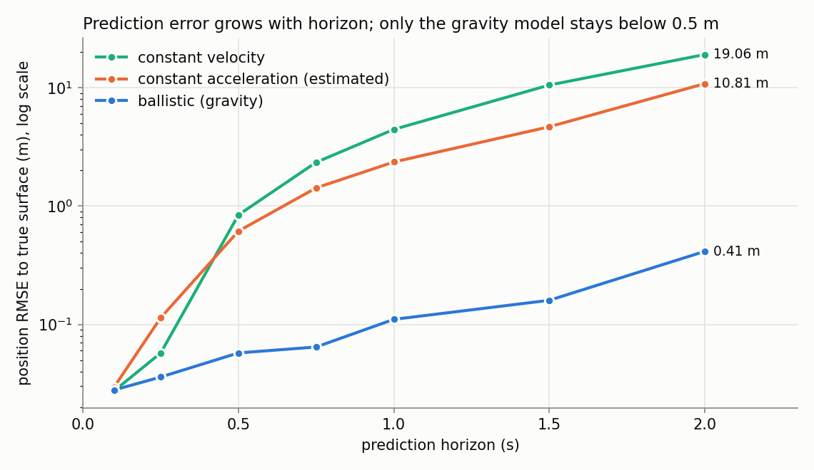
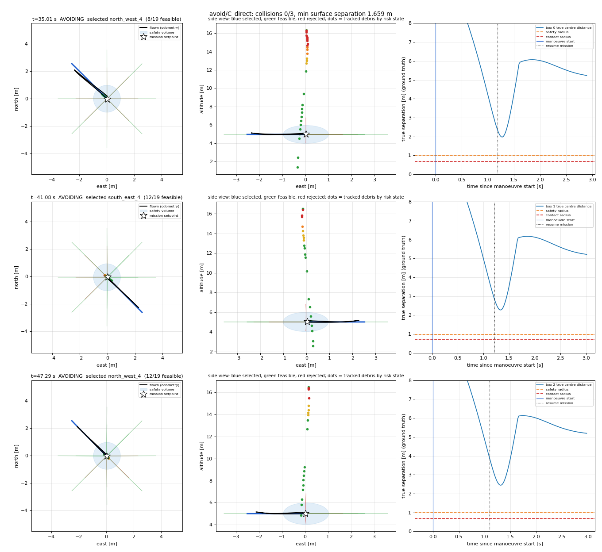
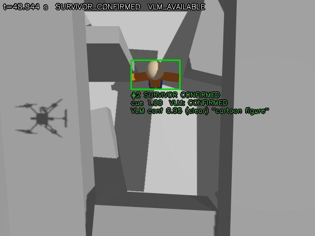

# Results overview (Phases 0–7)

Short version of [`MASTER_RESULTS.md`](MASTER_RESULTS.md). All numbers are
from simulation and have their source file listed in
[`METRICS_SUMMARY.md`](METRICS_SUMMARY.md).

## 1. The UAV flies by itself (Phase 0)

5 of 5 hover flights pass every check made on the PX4 log: takeoff
6.69–7.27 s, altitude RMSE 0.070–0.096 m, landing 0.015–0.059 m from the
takeoff point. A safety monitor detects an impact and hands over to PX4
AUTO LAND within 0.1 s (shown on a real roof collision).

## 2. The simulation is trustworthy (Phase 1)

Real-time factor 0.9986 with both cameras at 30 Hz (NVIDIA GPU). PX4 and
Gazebo time agree to 0 ms after a measured fix. An upward depth camera was
chosen from a measured sensor study.

## 3. It sees, tracks and predicts falling debris (Phases 2–4)

| Stage | Result |
|---|---|
| Detection | 86 of 86 objects, 98.7 % frame recall, 0 false detections in 1852 |
| Tracking | 0 ID switches; velocity RMSE 0.07–0.43 m/s |
| Prediction | 0.110 m error 1 s ahead (4.44 m with a constant-velocity model) |

## 4. It knows which debris is dangerous (Phase 5)

All 10 true collisions were flagged CRITICAL; recall 0.954, precision 0.61
in free fall; median warning 0.80 s before closest approach.

## 5. It gets out of the way — within limits (Phases 6, 6.1)

| | Without avoidance | With avoidance |
|---|---|---|
| Runs with a collision (14 scenarios) | 11 | 5 |
| Missions completed | 3 | 10 |

15 of 15 direct hits on a hovering UAV were avoided. Steady cruise up to
4.4 m/s: 0 collisions in 8 flights. **It still fails** when the warning is
shorter than about 0.9 s: hard-acceleration transit, short lateral throws,
and inside the roof opening.

## 6. It finds the survivor and a VLM checks it (Phase 7)

Candidate detector: recall 1.00, precision 0.72. VLM (local gemma3:4b):
0 false confirmations on 100 non-survivors; 24 of 45 clear survivors
confirmed (0 of 13 from straight above). Live: 4 of 8 survivors confirmed.
Without a VLM the system never reports a confirmation.

## 7. What is not done

Survivor 3D localisation, search, mission logic, the natural-language
interface and the integrated mission (Phases 8–15). The two perception
chains have not been flown together. GPS-denied navigation is not
implemented. See [`LIMITATIONS_AND_FAILURES.md`](LIMITATIONS_AND_FAILURES.md)
and [`PHASE_STATUS.md`](PHASE_STATUS.md).
